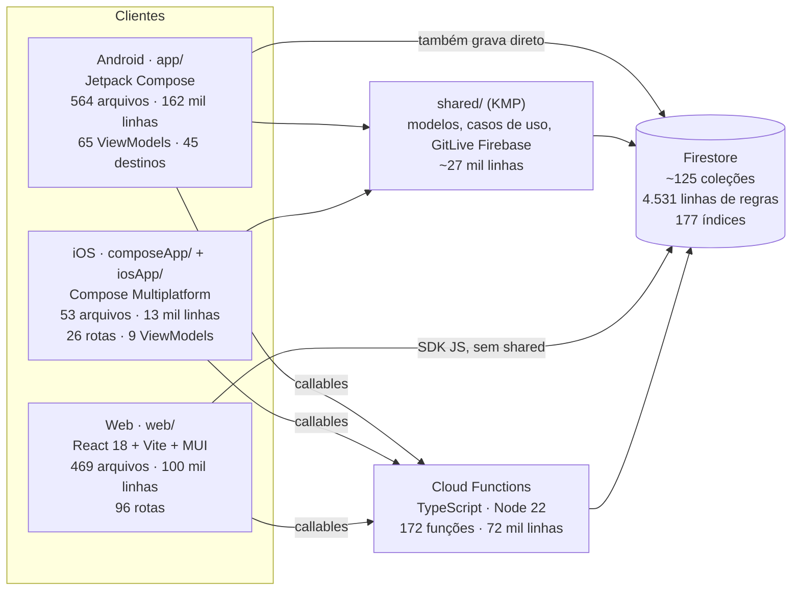

# 01 · Diagnóstico (14/11/2026)

Base lida: `master` em `658de9b2` (depois dos PRs #4551, #4552 e #4553). Nada foi compilado, testado nem executado: é leitura de código e de documentos.

## Como ler

- **[lido]** = está no código ou no documento citado, com `arquivo:linha`.
- **[conta]** = número obtido por `find`/`grep`/`wc`; é aproximado.
- **[hipótese]** = dedução minha, não confirmada.
- O que não consegui verificar está na seção 12.

Este arquivo não substitui o `DIAGNOSTICO.md` de 04/11 (bugs B1–B10, riscos R1–R12, divergências N1–N6). Aquele olha a casa por dentro; este olha o produto inteiro com a pergunta "aguenta virar um produto pago por donos de quadra, com 1000 usuários ou mais?". A relação entre os dois está na seção 11.

## 1. Resumo em uma tela

1. **São três aplicativos, não um.** Android nativo (`app/`, 162 mil linhas), iOS em Compose Multiplatform (`composeApp/`, 13 mil linhas) e web em React (`web/`, 100 mil linhas sem testes). Só o `shared/` (27 mil linhas) é comum a Android e iOS; a web não compartilha nenhum código Kotlin. [conta]
2. **A web é a plataforma mais completa; o iOS, a mais magra.** Mensalidade, painel do dono de quadra e cobrança de quadra só existem na web. O iOS não tem partida ao vivo, não cria grupo, não entra por código e não sorteia times.
3. **A mesma regra está escrita duas ou três vezes.** 62 modelos com o mesmo nome em `app` e em `shared`, um conversor de 1.926 linhas entre eles, três repositórios duplicados, XP em três linguagens, times gravados em lugares diferentes pelo Android e pela web.
4. **O lado "dono de quadra" já começou, mas pela cobrança, não pelo valor.** Existem conta comercial, ciclos, carência, suspensão, comprovante e livro-razão de assinatura. Não existem reserva, agenda da quadra nem caixa da quadra. O que se cobra hoje é o direito de aparecer na lista.
5. **Duas partidas podem ser marcadas na mesma quadra e no mesmo horário.** O conflito é só um aviso no cliente; a gravação não confere sobreposição.
6. **O caixa que existe é da pelada (grupo), não da quadra.** É bem feito (só o servidor grava, idempotente, com estorno), e serve de molde.
7. **O Pix do app é de mentira.** O "copia e cola" do Android tem telefone fixo e CRC aleatório, e a tela que o usaria não é aberta por ninguém.
8. **O começo do jogador contraria a regra da casa.** Android pede login antes de mostrar qualquer coisa; iOS pede notificação ao abrir; e, desde 03/10/2026, quem não verificou telefone e CPF não consegue nem ler um jogo.
9. **Custo de Firebase não é o problema nesta escala.** Com 1.000 a 10.000 usuários a conta estimada fica em dezenas de dólares por mês (ver `05-arquitetura-e-dados.md`). O problema é o custo de manter três bases e 4.531 linhas de regras.
10. **A rede de testes é boa no servidor e na web, fraca no app.** Cerca de 1.500 testes de regras e 132 arquivos de teste nas Functions; no Android não há medição de cobertura, e o pre-push não roda Gradle.

## 2. Arquitetura por plataforma

| | Android | iOS | Web |
|---|---|---|---|
| Interface | Jetpack Compose em `app/` | Compose Multiplatform em `composeApp/`; `iosApp/` é só a casca Swift (`iosApp/iosApp/ContentView.swift:14-21`) | React 18, Vite 8, MUI (`web/package.json:30-44`) |
| Navegação | `AppNavGraph.kt:231` (45 destinos), 5 abas (`MainActivityCompose.kt:576-620`) | `App.kt:446-1185` (26 rotas), 4 abas, sem Ranking (`composeApp/.../ui/HomeScreen.kt:102-126`) | `App.tsx`, 96 `<Route>` |
| ViewModels | 65 em `app/` | 9 em `composeApp/` | hooks + TanStack Query |
| Acesso a dados | duas pilhas: `app/.../data/datasource/FirebaseDataSource.kt:20` (SDK Android) e `shared/.../platform/firebase/FirebaseDataSource.kt:20` (GitLive) | só a do `shared`; várias rotas leem o Firestore direto, sem repositório (`App.kt:564-580`) | 111 arquivos importam `firebase/firestore` direto |
| Banco local | Room v7 **e** SQLDelight, os dois ao mesmo tempo (`AppDatabase.kt:17-28`, `shared/build.gradle.kts:147-155`) | nenhum (o `composeApp` não cria o `FutebaDatabase`) | cache do SDK |
| Injeção | Koin, 12 módulos (`KoinModules.kt:3-16`) | Koin, com `koinInjectOrNull` e tela "indisponível" quando falta dependência (`App.kt:517,636,1103`) | Context |

Versões [lido]: Kotlin 2.4.21, AGP 9.4.1, Compose Multiplatform 1.10.3 (`build.gradle.kts:3-15`); Koin 4.1.1, Firebase BoM 33.7.0, Room 2.8.5 (`app/build.gradle.kts:259-392`); SQLDelight 2.2.1, Ktor 3.6.0, GitLive 2.7.0 (`shared/build.gradle.kts:5,67,78`). Não há catálogo de versões (`gradle/libs.versions.toml` não existe); cada número está escrito no arquivo de build que o usa.

Alvos do KMP [lido]: `shared` e `composeApp` só compilam para Android e iOS (`shared/build.gradle.kts:17-33`, `composeApp/build.gradle.kts:10-26`). Não há alvo JS nem Wasm, então a web não pode consumir o `shared` hoje.

## 3. Compartilhado × duplicado

| O que | Onde está duplicado | Evidência |
|---|---|---|
| Modelos de domínio | 62 nomes de classe em `app/.../data/model` (97 classes) e em `shared/.../domain/model` (139 classes) | `Game.kt:15` × `Game.kt:92`; `Location.kt:17` × `Location.kt:11`; conversores em `app/.../util/ModelMappers.kt` (1.926 linhas) |
| Modelos na web | reescritos em TypeScript | `web/src/types/game.ts:155`, `group.ts:21`, `location.ts:27`, `user.ts:11` |
| `GameRepository` | interface em `app` (com implementação) e outra em `shared` (**sem implementação**) | `app/.../data/repository/GameRepository.kt:37`; `shared/.../domain/repository/GameRepository.kt:19`. O #4552 fez o `GameDetailViewModel` voltar a usar a do `app` |
| `AuthRepository`, `GroupRepository`, `LiveGameRepository` | um em `app`, outro em `shared` | `app/.../AuthRepository.kt:29` × `shared/.../AuthRepository.kt:15`; `GroupRepository.kt:61` × `:14`; `LiveGameRepository.kt:13` × `:19` |
| Criar grupo | o do `app` grava grupo + membro + índice em transação; o do `shared` só grava o grupo | `app/.../GroupRepository.kt:151-174` × `shared/.../FirebaseGroupsDataSource.kt:86` |
| Documento do usuário | criado em três lugares | Android `AuthRepository.kt:182`; web `AuthContext.tsx:266`; Function `user-management.ts:30` |
| Times do jogo | Android grava a coleção `teams`; a web grava `team1_players`/`team2_players` dentro do jogo | `GameTeamRepositoryImpl.kt:108-125` × `web/src/pages/games/TeamFormationScreen.tsx:383-391` |
| Placar ao vivo | dois escritores: a callable e um `set` direto do cliente | `functions/src/games/live-events.ts:584-603` × `FirebaseGamesDataSource.kt:714,727` |
| Tabela de XP | Kotlin, TypeScript da web e TypeScript das Functions; a fonte comum é um JSON | `shared/xp-constants.json`; `web/src/types/gamification.ts:3`; `XPCalculator.kt:105` (só usado em teste) |
| Sorteio de times | Kotlin e TypeScript; no Android a tela passa `balanceTeams=false` e apenas embaralha | `BalancedDrawAlgorithm.kt:33`; `web/src/utils/balancedDraw.ts`; `TeamFormationViewModel.kt:684` |

Consequência prática: cada funcionalidade nova (a agenda da quadra, por exemplo) custaria três implementações de tela e duas ou três de regra se nada mudar.

Verificação do grafo de injeção [lido]: não há `checkModules` nem `verify()`. O `KoinGraphTest` confere uma lista manual de tipos (`app/src/test/.../di/KoinGraphTest.kt:40`). Foi assim que as definições ausentes dos PRs #4551/#4552 chegaram à loja.

## 4. Dados: Firestore, regras e índices

- **Cerca de 125 blocos `match`** em `firestore.rules` (4.531 linhas), com negação total no fim (`firestore.rules:4527`). **177 índices compostos**; `games` tem 38, `season_participation` 20, `locations` 14 (`firestore.indexes.json`). [conta]
- **Domínios** [lido]: usuários (`users` + 13 subcoleções, `users_private`, índices de CPF/telefone/CNPJ por hash), social (`chats`, `activities`, seguidores), grupos (`groups` + membros, pedidos, mural, enquetes), jogos (`games`, `confirmations` na raiz, `schedules`, `teams`, caronas, fotos e vídeos), ao vivo (`live_games`, `game_events`, `live_scores`, `mvp_votes`), gamificação (`xp_logs`, `rankings`, `seasons`, `user_badges`, `challenges`, `weekly-rankings`), locais (`locations` + `fields`, `reviews`, `availability`), financeiro do grupo (`groups/*/cashbox`, `monthly_finance_*`), cobrança de quadra (`venue_accounts`, `venue_owner_onboarding`, `subscription_payments`, `subscription_ledger`, `billing_automation_*`), notificações e administração.
- **Papéis** [lido]: globais por *custom claim* (`ADMIN`, `FIELD_OWNER`, `PLAYER`), sem leitura (`firestore.rules:216-226`); de grupo por documento (`OWNER`, `ADMIN`, `MEMBER`, `firestore.rules:411-417`); de quadra por `owner_id` e `managers[]` no documento do local (`firestore.rules:482-488`). **Não existe papel de funcionário com permissão parcial** (atendente que lança, mas não estorna, por exemplo).
- **Custo das regras** [lido]: 81 `get()`, 17 `exists()`, 24 `getAfter()`. Ler um jogo custa de 0 a 2 leituras extras; ler um grupo privado, 2 (`firestore.rules:1174`, `:2408`).
- **Portão de verificação** [lido]: `isVerifiedOrGrace()` exige o claim `verified` ou data anterior a 03/10/2026 (`firestore.rules:234-244`; `functions/src/auth/verification-grace.ts`). A carência acabou. Ele protege a leitura de jogos (`firestore.rules:1174`, `:1185`). O claim nasce depois de SMS + CPF (`ESSENCIA.md`, 3.14).
- **Resíduos** [lido]: `fields` na raiz é legado (`firestore.rules:2355`); `locations/*/availability` tem regra (`:2333`) e nenhum código que a use; o comentário de `firestore.rules:164-168` traz e-mails reais de pessoas (o arquivo é versionado: convém tirar).
- **Testes das regras** [conta]: 87 arquivos, cerca de 1.517 casos, com emulador (`firestore-rules-tests/package.json`).

## 5. Cloud Functions

- TypeScript, Node 22, `firebase-functions ^7.4.0`, região `southamerica-east1`, `maxInstances: 10`, 512 MiB, 120 s, sem `minInstances` (`functions/package.json:25-32`; `functions/src/index.ts:24-32`).
- **172 funções exportadas** [conta]: ~90 callables (45 pelo invólucro `secureCallable`, que aplica App Check e limite de chamadas), 46 gatilhos do Firestore, 32 agendadas, 4 de Storage, 1 HTTP (`publicGamePage`), 1 de Auth.
- **Fan-out** [lido]: uma escrita em `games/{id}` dispara **11 gatilhos**; `users/{id}`, 8. Criar um jogo notifica todos os membros ativos, com uma leitura de preferências por pessoa (`notifications/game-notifications.ts:316-350`; `notifications/helpers.ts:705-707`). O XP roda uma transação por jogador confirmado (`xp/on-game-status-update.ts:215-222`).
- **Agenda** [lido]: `processNotificationBatch` roda a cada minuto (`notifications/batch-sender.ts:1585`); há tarefas de 5, 10, 15 e 30 minutos e 14 diárias. Só a agenda gera cerca de 71 mil invocações por mês, com zero usuários [conta]. Cabe na cota gratuita de 2 milhões, então custa pouco; o ponto é o ruído e as leituras que cada tarefa faz.
- **O que está bem feito** [lido]: financeiro só pelo servidor, com `requestId` idempotente (`cashbox/callable.ts:175,476`); presença em transação (`games/join-public-game.ts:291`); eventos ao vivo em transação com limite de 20 por minuto (`games/live-events.ts:173-174,584-603`); pós-jogo inteiro no servidor.

## 6. Custo e escala hoje

Pontos quentes no cliente [lido/conta]: 42 *listeners* em tempo real no `app`, 26 no `shared`, 82 na web. Os piores:

1. `app/.../GroupRepository.kt:273`: escuta **todos** os grupos públicos, sem limite.
2. `web/src/hooks/useMonthlyFinance.ts:314-390`: 7 *listeners* de uma vez, três sem limite.
3. `app/.../SocialFeedRepository.kt:280`: um *listener* por bloco de grupos sobre `wall_posts`.
4. `DirectMessagesRepository.kt:47` e `web/src/hooks/useDirectMessages.ts:127`: todas as conversas, sem limite.
5. `ConfirmationUseCase.kt:392,401`: *collection group* de três meses, sem limite.
6. `FirebaseUsersDataSource.kt:991`: *listener* de notificações usado como contador.
7. `web/src/pages/game/LiveGameScreen.tsx:354,382,407`: três coleções sem limite, em cada espectador.
8. Leitura em laço: `web/src/hooks/useNextGame.ts:65-67`, `WeeklyRecapScreen.tsx:160`, `useRecentLocations.ts:91`.

O modelo de custo que existe (`docs/production-launch/firebase-cost-model.md:12-42`) supõe 120 leituras e 12 escritas por sessão e 20 invocações por usuário ao mês. Ele ignora as ~71 mil invocações fixas da agenda e o fan-out dos gatilhos. Os orçamentos citados são US$ 10/dia, 50/semana e 200/mês (`:81-83`); não confirmei se estão criados no Google Cloud.

Limite que importa mais que o preço: `maxInstances: 10` sem `minInstances` significa partida a frio em qualquer callable pouco usada. Para uma recepção de quadra lançando pagamento, um ou dois segundos de espera são sentidos. [hipótese]

## 7. Fluxos principais

| Fluxo | Onde mora a regra | Divergência ou risco |
|---|---|---|
| Login | Android: Google e e-mail (`LoginActivityCompose.kt:162`, `LoginViewModel.kt:84`). Web: Google e e-mail (`AuthContext.tsx:722-883`). iOS: só e-mail (`IosFirebaseBridge.swift:21,40`) | iOS sem Google ("não configurado", `composeApp/.../LoginViewModel.kt:120-123`). Existe `AppleSignInService.swift`, sem uso que eu tenha achado. Sem login anônimo |
| Criar e entrar em grupo | cliente em transação (Android e web) + Function `onInviteRedeemed` | iOS só lista e mostra |
| Criar jogo | **cliente grava direto** (`GameRepositoryImpl.kt:395-405`; `useGames.ts:607`; iOS `FirebaseGamesDataSource.kt:148`) | a regra só confere se o local está comercialmente liberado (`firestore.rules:644-659`), não o horário |
| Presença | callable `confirmGamePresence` em transação; a lotação conta confirmados e pendentes (`join-public-game.ts:236-242,291`) | cancelar é escrita direta do cliente (`FirebaseGamesDataSource.kt:248-260`) |
| Lista de espera | servidor avisa o próximo e espera resposta; não confirma sozinho (`game-notifications.ts:568,663-666`) | só existe para o jogo, não para a quadra |
| Sorteio | no cliente | Android apenas embaralha; armazenamento diferente por plataforma |
| Ao vivo | callable `submitLiveGameEvent`; cronômetro só local (`LiveGameScreen.kt:289-297`) | iOS não tem a rota |
| Pós-jogo, XP, liga, conquistas | servidor (`voting/mvp-voting.ts`, `xp/`, `league.ts`, `badges/game-badges.ts`) | regra em um lugar só: é o padrão a copiar |
| Pagamento no jogo | chave Pix em texto no jogo e no grupo (`Group.kt:36`; `game.ts:203-206`) | código Pix simulado (`PaymentRepositoryImpl.kt:51-63`); QR por serviço de terceiros (`PaymentBottomSheet.kt:204`), sem quem abra a tela |

## 8. O que já existe de quadra, calendário, caixa e cobrança

**Locais e quadras** [lido]
- `Location` tem endereço, coordenadas, `ownerId`, `managers`, verificação, fotos, comodidades, horário de funcionamento, fuso IANA (`time_zone`, padrão `America/Sao_Paulo`) e um bloco comercial inteiro (`web/src/types/location.ts:49-150`; `shared/.../Location.kt:38-64,91,153`).
- `Field` tem tipo (society, futsal, campo, areia, outros), `hourlyPrice`, `minBookingMinutes` e regras (`location.ts:157-177`). A auditoria de maio registra preço zero em todas as quadras de produção (`specs/AUDIT_LOCATIONS_FIELDS_2026_05_31.md:22,106`).
- Criar local exige papel `FIELD_OWNER` ou `ADMIN`; nasce não verificado, em revisão e em teste (`firestore.rules:2087-2097`). Publicar e verificar é só do admin (`location-publication-ownership.ts:120`). Não existe "reivindicar um local que já está na lista".
- Gerentes entram por convite e aceite (`location-publication-ownership.ts:537,605,675`).

**Calendário e reserva** [lido]
- **Não há entidade de reserva, bloqueio nem mensalista de quadra.** A descrição do papel promete "reservas" (`shared/.../User.kt:34`) sem código por trás.
- A disponibilidade é derivada dos jogos: `getFieldAvailability` devolve os intervalos ocupados por jogos `SCHEDULED`, `CONFIRMED` ou `LIVE`, em janela de até 60 dias (`functions/src/games/field-availability.ts:10,14`).
- Conflito é aviso no cliente (`GameQueryRepositoryImpl.kt:1575-1627`; `FieldAvailabilityTimeline.tsx`). Sem transação.
- Recorrência existe para o **jogo** (`Schedule.kt:11,42`; `functions/src/games/recurrence-engine.ts:591`), não para a quadra.

**Caixa** [lido]
- É do grupo: `groups/{id}/cashbox` e `cashbox_summary`, sem escrita de cliente (`firestore.rules:2674,2682`). A quadra aparece só como categoria de despesa `FIELD_RENTAL` (`CashboxModels.kt:34`).
- Mensalidade do grupo: rateio em centavos, períodos rascunho/finalizado/fechado, baixa e estorno em transação (`functions/src/cashbox/monthly.ts:838-1619`; `docs/MONTHLY_FINANCE.md:52-79`). Tela só na web.
- Não há inadimplência calculada, nem exportação do caixa do grupo, nem abertura e fechamento de caixa.

**Cobrança do dono de quadra** [lido]
- Conta comercial `venue_accounts/{ownerUid}` com escopos por dono, por local, por número de quadras ou manual (`docs/VENUE_MONETIZATION.md:43-71`; `functions/src/admin/venue-accounts.ts:556`).
- Entrada do dono: `LEAD → IN_REVIEW → APPROVED`, aprovada à mão pelo admin, que então promove o usuário a `FIELD_OWNER` (`functions/src/admin/venue-owner-onboarding.ts:191,349`). O formulário pede contato, CNPJ e aceite de termos e fica atrás da verificação de conta (`web/src/pages/locations/OwnerOnboardingScreen.tsx:146-158`; `App.tsx:602`).
- Tarefa diária calcula ciclos pago, parcial, pendente, vencido e suspenso (`functions/src/locations/location-billing.ts:445-469`); carência de 5 dias e suspensão em 15 (`location-types-helpers.ts:258-259`).
- **Pagamento é manual**: o dono envia comprovante e o admin confere (`location-billing.ts:1087,1201,1297`). Histórico imutável em `subscription_ledger`.
- Os códigos de plano existem (`TRIAL`, `BASIC`, `PRO`, `ENTERPRISE`, `CUSTOM`), mas **nenhum documento ou código traz preço**.
- A regra central hoje é "local só aparece para o jogador se estiver ativo, verificado, publicado e em dia" (`docs/VENUE_MONETIZATION.md`, "Core Rule").

**Paridade** [lido]: tudo isso existe na web (`FieldOwnerDashboardScreen.tsx`, `ManageLocationsScreen.tsx`, `OwnerOnboardingScreen.tsx`). O Android cria e edita local e quadra, e o painel do dono só lista (`FieldOwnerDashboardViewModel.kt:61`). O iOS só lê.

**Monetização do jogador** [lido]: faixa do AdMob nas abas principais, só depois da primeira presença ou do primeiro jogo, sempre não personalizada (`shared/.../AdsPolicy.kt:15-33`; `docs/MONETIZACAO.md:13,16`). "Sem anúncios" a R$ 9,90 por ano pelo Play Billing e pelo StoreKit 2; o direito fica só no aparelho, **sem validação no servidor** (`docs/MONETIZACAO.md:41-45`).

## 9. Onboarding e portões hoje

| Plataforma | O que acontece | Evidência |
|---|---|---|
| Android | abertura → login obrigatório → boas-vindas → permissões (notificação) → perfil → carrossel | `SplashActivityCompose.kt:140-144`; `OnboardingFlow.kt:19-25` |
| iOS | boas-vindas → permissões → login; mas o pedido de notificação dispara ao abrir o app | `App.kt:448-457`; `AppDelegate.swift:18-19` |
| Web | visitante vê a página inicial, `/parcerias` e a prévia pública do jogo; o resto pede login; a notificação é pedida na Home | `web/src/App.tsx:280,528-543,547-636`; `HomeScreen.tsx:76` |
| Todas | para ler jogos é preciso o claim `verified` (SMS + CPF) | `firestore.rules:234-244,1174` |

Não existe modo visitante. O caminho mais curto até "estou na lista da pelada" passa por login, perfil, SMS e CPF.

## 10. Qualidade

- **Testes** [conta]: `app/src/test` 95 arquivos e 1.082 `@Test`; `androidTest` 18 e 128; `shared/commonTest` 22 e 275; `composeApp` 6 e 33; web 355 arquivos de teste unitário e 9 de ponta a ponta; Functions 132; regras 87. Não há Kover nem JaCoCo; o único limite de cobertura é o das Functions, 80% sobre o que mudou (`.github/workflows/functions-ci.yml:224`).
- **CI** [lido]: 32 workflows. O executor vem de variáveis `RUNNER_LABELS_*`, documentadas como self-hosted (`docs/CI_RUNNERS.md:28-31`); fork e dependabot caem em `ubuntu-24.04`. iOS usa o runner do Mac (`ios-build.yml:118,152`).
- **Ganchos locais** [lido]: os ganchos ficam em `.husky/`; não existe `.githooks/` no repositório. O pre-push roda tipos e lint da web, build e lint das Functions (`scripts/validate-pre-push.sh:42-83`). **Não roda Gradle, detekt nem testes Kotlin.** No clone do Mac, `core.hooksPath` está configurado como `.githooks` (em `.git/config`), pasta que não existe: **nesta máquina nenhum gancho roda**, nem o pre-push.
- **Análise estática** [lido]: detekt 1.23.8 com `maxIssues: 80` (`detekt.yml:6`) e linhas de base de 77 (app), 28 (shared) e 5 (composeApp); Android Lint com `abortOnError=false` e linha de base de 1.888 itens (`app/build.gradle.kts:177-189`).
- **Arquivos gigantes** [conta]: 41 arquivos `.kt` acima de 800 linhas. `composeApp/.../compose/App.kt` tem 2.654 (rotas inteiras dentro do arquivo), `ModelMappers.kt` 1.926, `TeamFormationScreen.kt` 1.723.
- **Observabilidade** [lido]: Crashlytics, Performance e Analytics no Android; Crashlytics e Analytics no iOS; `monitoring/manifest.json` com 12 alertas.
- **Dívidas da semana** (informadas pelo Renan, não investiguei a causa): tela branca na partida, cartão de login cortado, PRs de iOS #4548 e #4549 abertos.

## 11. Relação com o diagnóstico de 04/11

O `PLANO.md` de 04/11 organizou ondas A a I. Pelo histórico (#4500 a #4532), A, B, C, F, G, H, I e boa parte da D foram entregues; a **Onda E (dependências) parece não ter sido feita**: a web ainda usa ESLint 8, e os BoMs de Firebase e Compose continuam em 33.7.0 e 2025.09.01 (`app/build.gradle.kts:232,278`). Os números de tamanho daquele diagnóstico envelheceram (o `functions/src/index.ts` caiu de 2.955 para 1.250 linhas, por exemplo). A decisão de stack de então (manter KMP + Compose Multiplatform + React) continua sendo a base deste projeto.

O que este diagnóstico acrescenta: o custo de três bases para um produto que vai dobrar de tamanho, o estado real do lado B2B, o portão de verificação diante da regra "login só depois da primeira vitória", e a falta de reserva transacional.

## 12. Não verificado

- **Uso real**: número de usuários ativos, de grupos, de quadras cadastradas e de donos. Não consultei produção nem o Analytics. O comentário histórico das regras fala em 4 usuários migrados (`firestore.rules:164`); é antigo e não diz o tamanho de hoje.
- **Fatura real** do Firebase e se os orçamentos existem no Google Cloud.
- **O que está implantado**: se as 172 funções do repositório são as que estão em produção, e se a tarefa de cobrança de quadra roda.
- **Configuração de console**: App Check obrigatório em Firestore, Storage e Auth; local do banco do Firestore.
- **Situação nas lojas**: o pedido diz Play 1.43.0 e App Store 1.10.0; o `versions.json` do repositório registra Android 1.44.0 (build 85) e iOS 1.10.0 (build 29). Não abri os consoles.
- **Causa** da tela branca na partida e do cartão de login cortado. [hipótese a testar, sem evidência]: usuário sem `verified` tem a leitura de `games` negada desde 03/10, o que poderia aparecer como tela vazia.
- Se o iOS tem persistência local do Firestore ligada por padrão, e quantas das 26 rotas do iOS têm paridade real com o Android.
- Se o servidor lê os times gravados pela web (`team1_players`) ou só a coleção `teams`.
- Nenhuma tela foi aberta; nenhum build ou teste foi rodado.
