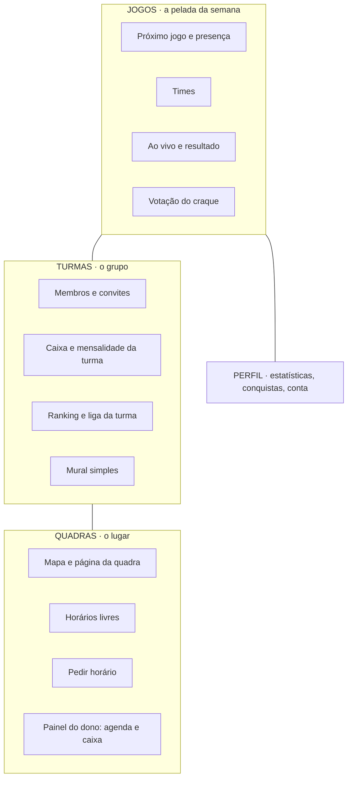
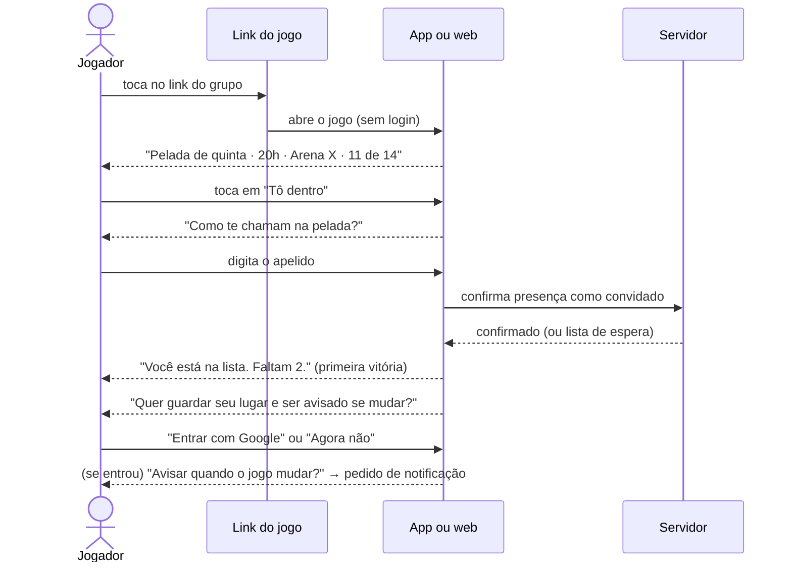

# 02 · Produto e onboarding

Tudo aqui é **proposta**, salvo o que estiver marcado como [lido] (com a fonte no `01-diagnostico.md`). Textos de tela entre aspas são sugestões de redação em português do Brasil; nenhum usa "IA".

## 1. A ideia em três frases

O Futeba dos Parças deixa de ser "um app de pelada com muita coisa" e passa a ser **o lugar onde a pelada e a quadra se encontram**. O jogador e o organizador usam de graça, porque são eles que enchem a agenda. Quem paga é a quadra, por um motivo que ela entende em um minuto: agenda sem buraco e caixa sem planilha.

## 2. Personas

| Persona | Quem é | O que quer resolver | Primeira vitória |
|---|---|---|---|
| **Jogador** | recebeu um link no grupo do WhatsApp | saber se vai ter jogo, dizer que vai, saber onde e quanto | "Você está na lista" em menos de 10 segundos, sem cadastro |
| **Organizador** | o cara que marca a pelada toda semana | parar de contar "eu vou" no WhatsApp, fechar o time, cobrar a mensalidade | lista de presença pronta e link enviado ao grupo em menos de um minuto |
| **Dono ou gestor de quadra** | dono de arena society, de 1 a 6 quadras; hoje usa caderno, planilha ou WhatsApp [suposição] | não vender o mesmo horário duas vezes, saber quem deve, fechar o caixa do dia | ver a própria semana montada na tela e marcar o primeiro horário |
| **Funcionário da quadra** | atendente de recepção ou do bar | marcar horário, receber, não ser culpado pela diferença de caixa | receber um pagamento com dois toques |
| Administrador (TECHFERNANDES) | o Renan | aprovar quadras, acompanhar cobrança, dar suporte | uma fila única do que precisa dele |

O que a persona do dono **não** quer: virar usuário de rede social de futebol. O painel dele é de trabalho.

## 3. Mapa do produto: mais lógico

### 3.1 Hoje

Cinco abas no Android (Início, Jogos, Grupos, Ranking, Perfil), quatro no iOS, 96 rotas na web [lido]. Em volta do núcleo cresceram: mensagens diretas, feed social, seguidores, time dos sonhos, elencos favoritos, caronas, enquetes, desafios, temporadas, liga com divisões, sequências, resumo semanal, fotos e vídeos de jogo com miniatura gerada no servidor, mural com mídia, avaliação de local, reputação. Cada item tem coleção, regra, índice e Function próprios.

### 3.2 Proposto: três pilares e um perfil

Quatro abas em todas as plataformas: **Jogos · Turmas · Quadras · Perfil**. Para o dono de quadra, a aba Quadras abre direto no painel dele.

### 3.3 O que fica, o que se funde, o que sai

| Hoje | Proposta | Por quê |
|---|---|---|
| Início + Jogos | **Fundem** em "Jogos": a primeira coisa na tela é o próximo jogo, com o botão de presença embaixo | uma ação principal por tela |
| Ranking global + liga + temporadas | **Vão para dentro da Turma** (ranking entre amigos) e do Perfil (meu histórico). Ranking global sai da navegação principal | com poucos usuários, ranking global não significa nada; entre amigos, significa |
| Conquistas, XP, níveis, sequências | **Ficam**, no Perfil, calculadas no servidor como já são | é a graça do app e já está certo |
| Caixa do grupo + mensalidade | **Fundem** em "Caixa da turma" e chegam ao Android e ao iOS (hoje a mensalidade é só da web) | mesma função, mesmo lugar |
| Mapa de locais + detalhe + painel do dono | **Fundem** em "Quadras" | um pilar só |
| Chave Pix em texto no jogo | **Fica**, mas vira código Pix válido gerado a partir da chave (ver `03`, seção 5.4) | o que existe hoje é simulado |
| Sorteio de times | **Fica**, com um algoritmo só e um jeito só de gravar | hoje há diferença entre Android e web |
| Mensagens diretas, feed social, seguidores, time dos sonhos, elencos favoritos, desafios, caronas, enquetes, vídeos de jogo | **Candidatos a sair ou congelar.** Decidir com 30 dias de dados de uso | cada um custa regras, moderação e três telas. O grupo já conversa no WhatsApp. **Não verifiquei o uso**: por isso é decisão, não recomendação fechada |
| Verificação por SMS + CPF para todo mundo | **Sai do caminho do jogador**; fica para quem mexe com dinheiro (ver 4.4) | hoje barra a primeira vitória |
| Android Auto, traduções incompletas e telas órfãs | seguem o que o `PLANO.md` de 04/11 já decidiu (D15, D16, D18) | não reabrir |

Regra para os "candidatos a sair": ninguém perde dado. Recurso desligado some da navegação por flag, os dados ficam guardados e exportáveis pelo "Exportar meus dados" que já existe, e a remoção de código é um passo separado, depois.

## 4. Onboarding do jogador

### 4.1 Princípios

1. Valor em 10 segundos, contados a partir do toque no link.
2. Uma ação principal por tela, em botão de 56 px na parte de baixo.
3. Login só depois da primeira vitória; notificação só quando houver um motivo na tela.
4. Nunca perguntar o que dá para descobrir depois.

### 4.2 Caminho A: chegou por um link (o mais comum)

| # | Tela | Texto principal | Botão embaixo | Observação |
|---|---|---|---|---|
| 1 | Jogo (pública) | "Pelada de quinta, 20h · Arena X" + quem já confirmou | **Tô dentro** | já existe uma prévia pública em `/game/:id` na web [lido]; no app, o link abre a mesma tela |
| 2 | Apelido | "Como te chamam na pelada?" | **Confirmar presença** | um campo só. Opcional: "Sou goleiro" |
| 3 | Vitória | "Você está na lista. Faltam 2 para fechar." | **Ver quem vai** | se lotou: "Você é o 2º da espera. A gente avisa se abrir vaga." |
| 4 | Guardar | "Guarde seu lugar para não perder se trocar de celular." | **Entrar com Google** (e "Entrar com Apple" no iPhone) | link discreto "Agora não". Quem pula continua como convidado neste aparelho |
| 5 | Aviso | "Quer saber se o horário ou o local mudar?" | **Quero ser avisado** | só aqui aparece o pedido de notificação do sistema |

Depois disso o app não pede mais nada. Posição, foto e pé preferido aparecem como sugestões no Perfil ("Sugestão: diga sua posição para o sorteio ficar mais justo").

### 4.3 Caminho B: abriu o app sem link

| # | Tela | Texto principal | Botão embaixo |
|---|---|---|---|
| 1 | Abertura | "Sua pelada organizada em um minuto." | **Organizar minha pelada** (link menor: "Tenho um convite" e "Tenho uma quadra") |
| 2 | Novo jogo | "Quando é?" (dia e hora, com "toda semana" já marcado) | **Continuar** |
| 3 | Onde | "Onde vai ser?" (busca de quadra ou "depois eu digo") | **Continuar** |
| 4 | Vitória | "Pronto. Mande o link para a turma." (prévia da lista) | **Mandar no WhatsApp** |
| 5 | Guardar | "Entre para não perder sua pelada." | **Entrar com Google** |
| 6 | Aviso | aparece quando o primeiro amigo confirmar: "Fulano confirmou. Quer ser avisado dos próximos?" | **Quero ser avisado** |

Vagas, preço por pessoa, chave Pix, goleiros: tudo com valor padrão e editável depois, na tela do jogo. Hoje o `CreateGameViewModel` tem 1.329 linhas [lido] porque pergunta tudo de uma vez.

### 4.4 Quando pedir cada coisa

| Pedido | Quando | Hoje [lido] |
|---|---|---|
| Apelido | ao confirmar a primeira presença | depois do login, no perfil |
| Login | depois da primeira vitória; obrigatório para criar turma, organizar um segundo jogo, votar, entrar em ranking | antes de qualquer tela (Android) |
| Notificação | com um motivo na tela | Android: no onboarding; iOS: ao abrir o app; web: na Home |
| Telefone (SMS) | ao virar organizador com caixa, ou dono de quadra | para ler qualquer jogo |
| CPF | só para quem recebe dinheiro pelo app (dono de quadra; organizador que usa cobrança conciliada, fase futura) | para ler qualquer jogo |
| Localização | ao tocar em "Quadras perto de mim" ou no check-in | no onboarding |
| Pagamento | nunca para o jogador usar o app. "Sem anúncios" continua opcional, no Perfil | igual |

### 4.5 O que isso exige (e os riscos)

- **Conta de convidado.** Proposta: login anônimo do Firebase, promovido a conta Google/Apple sem perder a presença. Convidado não ganha XP, não vota e não entra em ranking; ao entrar com conta, o histórico do aparelho é vinculado.
- **Abuso por link.** Hoje a verificação por SMS e CPF existe como barreira contra robô e fraude de XP [lido]. Para não abrir a porta: App Check obrigatório, limite de chamadas (já existe no `secureCallable`), convidado não pontua, e o organizador pode ligar "aprovar convidados" na turma. **É uma decisão de segurança do Renan** (ver README, decisão 3).
- **Sign in with Apple.** Há um `AppleSignInService.swift` sem uso [lido]. Oferecer Google no iPhone pede uma opção de login equivalente em privacidade (diretriz 4.8 da Apple; citada de memória, confirmar o texto atual antes de implementar).
- **Regras do Firestore.** A leitura de jogo por convidado precisa de um caminho próprio: ou a projeção pública que já alimenta `/game/:id`, ou uma regra por convite. Não é afrouxar `games` para todos.

## 5. Onboarding do dono de quadra

### 5.1 Hoje [lido]

Formulário atrás de login e verificação (SMS + CPF) → pedido fica "em análise" → o admin aprova à mão → o usuário vira `FIELD_OWNER` → cadastra o local, que nasce "em revisão" → o admin publica. O dono não vê valor nenhum antes de alguém da TECHFERNANDES agir. E o que ele ganha no fim é aparecer na lista.

### 5.2 Proposto: a agenda antes do cadastro

```mermaid
flowchart LR
  A["Página /quadras<br/>agenda de demonstração<br/>tocável, sem cadastro"] --> B["Nome da quadra<br/>(busca a que já existe)"]
  B --> C["Quantas quadras?<br/>tipo de cada uma"]
  C --> D["Dias e horários<br/>de funcionamento"]
  D --> E["Primeira vitória:<br/>sua semana na tela,<br/>marque o primeiro horário"]
  E --> F["Entrar com Google<br/>para guardar"]
  F --> G["Mensalistas<br/>quem joga toda semana"]
  G --> H["Recebeu? → caixa<br/>abre sozinho"]
  H --> I["Equipe<br/>convide o atendente"]
  I --> J["Confirmar que a quadra é sua<br/>→ aparece para os jogadores"]
  J --> K["Fim do teste<br/>escolher plano (na web)"]
```

| # | Tela | Texto principal | Botão embaixo | Observação |
|---|---|---|---|---|
| 0 | Página `/quadras` (substitui `/parcerias`) | "Agenda e caixa da sua quadra, sem planilha." Abaixo, uma agenda de exemplo que responde ao toque | **Montar minha agenda** | valor em 10 segundos: a pessoa marca um horário de mentira antes de qualquer cadastro |
| 1 | Nome | "Qual é o nome da sua quadra?" | **Continuar** | ao digitar, sugere os locais já listados: "É esta aqui?". Se for, segue como reivindicação (5.4) |
| 2 | Quadras | "Quantas quadras você tem?" (contador) e o tipo de cada uma | **Continuar** | society, futsal, campo, areia: os tipos já existem [lido] |
| 3 | Horário | "Que dias e horários você abre?" | **Ver minha agenda** | padrão sugerido: todos os dias, 8h às 23h, horários de 1 hora |
| 4 | **Vitória** | "Sua agenda está pronta." A semana real, vazia, com as quadras dele em colunas | **Marcar um horário** | meta: chegar aqui em até 90 segundos |
| 5 | Primeiro horário | toca num espaço → "Quem vai jogar?" (nome e telefone opcional) | **Marcar** | o espaço fica ocupado na hora |
| 6 | Guardar | "Entre para guardar sua agenda." | **Entrar com Google** | só agora. Até aqui tudo ficou no aparelho |
| 7 | Mensalistas | "Quem joga toda semana?" (dia, hora, quadra, nome, valor) | **Adicionar mensalista** | "Pular por enquanto" visível. Cada mensalista ocupa a agenda dali em diante |
| 8 | Caixa | aparece na primeira vez que ele toca em um horário passado: "Recebeu?" | **Recebi** → dinheiro, Pix, cartão | o caixa se apresenta pelo uso, sem tela de configuração |
| 9 | Equipe | "Quem mais atende na quadra?" | **Convidar por WhatsApp** | papel padrão: Atendente (ver `03`, seção 5.10) |
| 10 | Aparecer para os jogadores | "Quer que os jogadores vejam seus horários livres?" | **Confirmar que a quadra é minha** | aqui entram telefone, CNPJ ou CPF e a conferência; a agenda privada funciona sem isso |
| 11 | Notificação | no primeiro pedido de horário que chegar: "Quer ser avisado quando pedirem horário?" | **Quero ser avisado** | |
| 12 | Plano | a partir do 21º dia de teste: "Seu teste termina em 9 dias." | **Ver planos** (abre a web) | no app do iPhone não aparece preço nem botão de compra (ver `04`) |

### 5.3 Marcos e medidas

| Marco | Definição | Meta inicial [suposição] |
|---|---|---|
| Agenda montada | chegou à tela 4 | 70% de quem tocou em "Montar minha agenda" |
| Ativada | 10 horários marcados nos 7 primeiros dias | 40% das agendas montadas |
| Caixa em uso | 5 recebimentos lançados na primeira semana | 25% |
| Equipe | pelo menos 1 funcionário convidado em 14 dias | 20% |
| Publicada | titularidade confirmada | 50% das ativadas |
| Pagante | assinatura ativa ao fim do teste | a medir no piloto; não chuto |

### 5.4 Reivindicar uma quadra que já está na lista

Hoje não existe [lido]. Proposta: o dono escolhe o local existente, informa telefone e CNPJ ou CPF, e a TECHFERNANDES confere por um destes meios: ligação para o telefone público da quadra, e-mail do domínio da quadra, ou documento. Enquanto não confere, ele usa a agenda em rascunho privado; nada do que ele marcar aparece para jogadores, e os jogos que já existem naquele local não são alterados. Aprovada a reivindicação, os jogos futuros daquele local entram na agenda como "jogo do app" (ver `03`, seção 4.6).

### 5.5 Onboarding do funcionário

Recebe um link no WhatsApp → "Fulano te convidou para atender na Arena X" → **Entrar com Google** → cai direto em "Hoje", com a agenda do dia e o botão **Receber**. Sem perfil de jogador, sem conquistas, sem abas que não são do trabalho dele.

## 6. Regras de produto que valem para tudo

- A interface nunca diz "IA": usa "Sugestão" e "Pergunte".
- Textos em português do Brasil, frases curtas, sem jargão ("horário", não "slot"; "recebimento", não "transação").
- Uma ação principal por tela, botão de 56 px embaixo.
- Nenhum anúncio em tela de dinheiro, de agenda, de painel do dono ou de erro (a `AdsPolicy` já veta rotas de pagamento, caixa, dono e admin [lido]).
- Erro sempre diz o que aconteceu e o que fazer: "Esse horário acabou de ser marcado por outra pessoa. Escolha outro."
- Estado vazio sempre tem um botão: "Nenhum horário marcado hoje" → **Marcar horário**.

## 7. Não verificado

- Como donos de quadra trabalham hoje (caderno, planilha, WhatsApp, outro sistema). As personas são suposição até conversar com 5 a 10 deles.
- Uso real de cada recurso candidato a sair.
- Metas de conversão: são pontos de partida, não previsões.
- Texto vigente da diretriz 4.8 da Apple.
