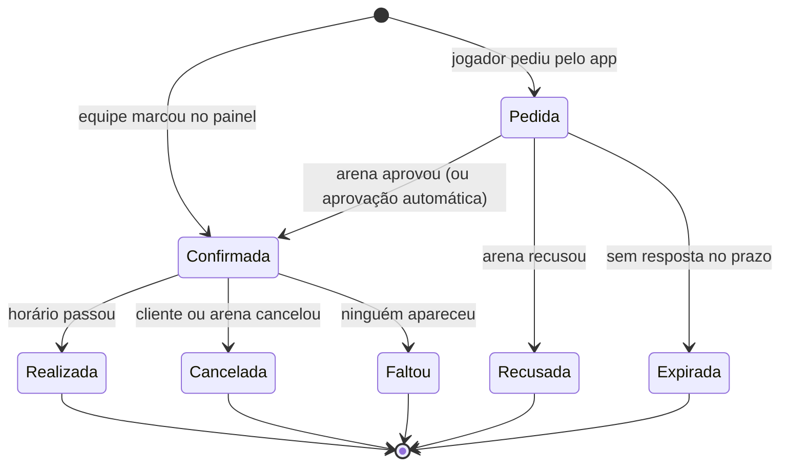
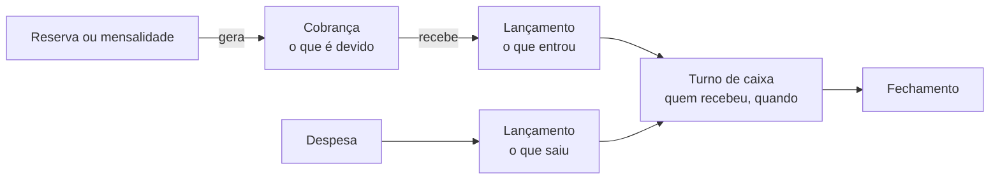

# 03 · Módulo do dono de quadra: calendário e caixa

Tudo aqui é **proposta de regra de negócio**. O que já existe no código está marcado como [lido], com a fonte no `01-diagnostico.md`. O desenho técnico (coleções, transações, regras de segurança) está no `05-arquitetura-e-dados.md`.

## 1. Vocabulário

| Na tela | No código hoje | O que é |
|---|---|---|
| **Arena** | `locations/{id}` [lido] | o estabelecimento: endereço, horário, equipe, plano |
| **Quadra** | `locations/{id}/fields/{id}` [lido] | cada espaço que se aluga |
| **Horário** | novo | um intervalo de uma quadra em um dia |
| **Reserva** | novo | um horário ocupado por alguém. Tipos: avulso, mensalista, jogo do app |
| **Bloqueio** | novo | um horário fechado pela arena (manutenção, evento, feriado) |
| **Mensalista** | novo | um cliente com horário fixo que se repete |
| **Cliente** | novo | quem aluga: pessoa ou turma. Pode ou não ter conta no app |
| **Cobrança** | novo | o que alguém deve à arena (uma conta a receber) |
| **Lançamento** | novo, no molde de `groups/*/cashbox` [lido] | dinheiro que entrou ou saiu. Nunca é editado |
| **Turno de caixa** | novo | o período entre abrir e fechar o caixa |

**Sobre "caixa por quadra".** Li o pedido como "por estabelecimento": o caixa é da **arena**, e cada lançamento leva a **quadra** como marcação, para os relatórios mostrarem receita e ocupação quadra a quadra. Uma arena pode ter mais de um ponto de caixa (recepção e bar, por exemplo). Se a intenção era um caixa físico separado para cada quadra, o modelo aguenta (um ponto de caixa por quadra), mas a operação fica mais pesada. Está na lista de decisões do README (decisão 8).

## 2. Cadastro: conta, arenas e quadras

- **Conta** é quem contrata. Hoje é `venue_accounts/{ownerUid}`, uma por dono [lido]. Uma conta pode ter várias arenas (rede).
- **Arena**: nome, endereço, contatos, fuso, dias e horários de funcionamento (já existem [lido]), mais: grade padrão (30 ou 60 minutos), política de cancelamento, chave Pix da arena, modo de caixa (simples ou por turno) e pontos de caixa.
- **Quadra**: nome, tipo, coberta ou descoberta, duração mínima (já existe `minBookingMinutes` [lido]), preço padrão por hora (já existe `hourlyPrice` [lido]) e **tabela de preço por faixa**.

Regras:

1. **Horário de funcionamento pode passar da meia-noite** (22h às 2h). O horário pertence ao "dia de operação" em que começou: 0h30 de sábado, numa arena que abre sexta às 18h e fecha às 2h, conta como sexta.
2. **Tabela de preço**: faixas por dia da semana e hora (ex.: segunda a sexta até 17h, R$ X; depois, R$ Y). Faixas não podem se sobrepor na mesma quadra. Hora sem faixa usa o preço padrão. Se uma reserva atravessa duas faixas, o valor é proporcional aos minutos em cada uma.
3. **O preço é congelado na reserva.** Mudar a tabela não muda o que já foi marcado.
4. **Quadras que dividem espaço.** Um campo que vira duas quadras society declara com quais quadras conflita. Reservar o campo ocupa as duas; reservar uma metade impede o campo.
5. **Desativar uma quadra** com reserva futura não é permitido: o sistema lista as reservas e pede para mover ou cancelar cada uma.
6. **Mudar o horário de funcionamento** não apaga reserva. Se alguma ficar fora do novo horário, aparece um aviso com a lista.
7. **Datas especiais**: feriado e recesso são bloqueios (seção 4.5), não uma agenda paralela.

## 3. Calendário: a grade

- **Dia**: quadras em colunas, horas em linhas. É a tela de trabalho da recepção.
- **Semana**: uma quadra por vez, dias em colunas. Serve para achar buraco e encaixar mensalista.
- **Lista**: os próximos horários, para o celular.
- Cores por tipo: avulso, mensalista, jogo do app, bloqueio. Um sinal para "pago", outro para "deve".
- Toque num espaço vazio → marcar. Toque num ocupado → ver, receber, mover ou cancelar.
- A grade (30 ou 60 minutos) é só o desenho da tela. O conflito é calculado pelo intervalo real, então mudar a grade nunca corrompe a agenda.

## 4. Calendário: regras

### 4.1 A regra de ouro

> Em uma quadra, em um instante, existe no máximo uma ocupação ativa.

Vale para avulso, mensalista, jogo do app e bloqueio. É garantida pelo servidor, em transação (ver `05`, seção 5.2). O aviso na tela ajuda, mas quem decide é o servidor. Hoje não há essa garantia [lido].

### 4.2 Estados de uma reserva

- **Pedida** segura o horário (ninguém mais marca) por um prazo configurável; padrão sugerido: 12 horas, ou até 2 horas antes do início, o que vier primeiro. Passado o prazo, vira **Expirada** e o horário é liberado.
- **Realizada** não é automática para o dinheiro: horário realizado e não pago vira cobrança vencida (seção 5.5).
- Só **Pedida** e **Confirmada** ocupam a agenda.

### 4.3 Avulso

1. Duração: múltiplo da grade, respeitando a duração mínima da quadra.
2. Antecedência máxima: 60 dias (igual à janela que a disponibilidade já usa hoje [lido]). Antecedência mínima: nenhuma no painel; configurável para pedidos de jogador.
3. Cliente: nome obrigatório; telefone opcional. Se o telefone bater com um cliente existente, reaproveita.
4. Valor: calculado pela tabela, editável por quem tem permissão (desconto ou cortesia exigem motivo).
5. Sinal: a arena pode pedir um valor antecipado. A reserva nasce com uma cobrança; o sinal é um pagamento parcial dela.
6. Mover: muda dia, hora ou quadra mantendo cliente, valor e pagamentos. É uma transação só (libera e ocupa juntos); se o destino estiver ocupado, nada muda.

### 4.4 Mensalista (recorrência)

Uma **série** tem: cliente, quadra, dia da semana, hora de início, duração, data de início, data de fim (ou "sem fim"), valor e modo de cobrança (seção 5.4).

1. **Frequência**: semanal ou quinzenal na primeira versão. (O jogo recorrente do app já tem semanal e quinzenal [lido].)
2. **As ocorrências viram reservas de verdade com 90 dias de antecedência.** Todo dia o sistema estende a janela. Como o avulso só pode ser marcado com até 60 dias, um avulso nunca cai em cima de um mensalista que ainda não foi gerado.
3. **Criar uma série confere todas as ocorrências da janela.** Se alguma bater com algo já marcado, o sistema mostra a lista ("3 de 13 datas já estão ocupadas") e o dono escolhe: criar pulando essas datas, ou não criar. Nunca sobrescreve.
4. **Exceções de uma data só**: cancelar aquela data, mover aquela data, trocar de quadra naquela data. A série continua igual.
5. **Mudar a série daqui para a frente** (novo horário, nova quadra, novo valor): encerra a série na data escolhida e cria outra a partir dali. O histórico fica intacto.
6. **Pausar** (férias, lesão): intervalo de datas em que as ocorrências são liberadas. A cobrança do período segue a regra da seção 5.4.
7. **Encerrar**: libera todas as ocorrências futuras. Cobranças em aberto continuam em aberto.
8. **Feriado**: a ocorrência existe normalmente, a menos que a arena bloqueie o dia.
9. **Mês com cinco semanas**: a quinta ocorrência existe. Se pesa ou não no valor depende do modo de cobrança.
10. **Reajuste de valor**: vale a partir da próxima competência; cobrança já gerada não muda.

### 4.5 Bloqueio

- Motivos: manutenção, evento, feriado, clima, uso próprio, outro (com texto).
- Pode ser de um horário, de um dia inteiro, de uma quadra ou da arena toda, e pode se repetir (toda segunda de manhã, por exemplo).
- **Bloqueio não passa por cima de reserva.** Se houver reserva no intervalo, o sistema lista cada uma e a pessoa resolve uma a uma: mover, cancelar (com o tratamento de crédito da seção 5.4) ou manter e encurtar o bloqueio.

### 4.6 Jogo do app (a pelada na quadra)

- Arena com **agenda gerenciada** (flag ligada quando o dono ativa o módulo): criar um jogo naquela quadra passa a ser um **pedido de horário**. O jogo guarda o identificador da reserva, e o horário aparece na agenda como "jogo do app", com o nome da turma.
- Arena sem agenda gerenciada: tudo continua como hoje (o jogo é só informativo; conflito é aviso).
- **Ativação**: os jogos futuros que já existem naquela arena entram como reservas. Se dois baterem, os dois ficam marcados como "conflito a resolver" na agenda. O sistema nunca cancela um jogo sozinho.
- Jogo cancelado pelo organizador → a reserva segue a política de cancelamento da arena.
- Reserva cancelada pela arena → o jogo continua existindo no app, com o aviso "A quadra cancelou este horário" e o botão **Escolher outro horário**.
- Jogo recorrente do app em arena gerenciada → vira proposta de série de mensalista, que a arena aprova uma vez.

### 4.7 Lista de espera da quadra

- O cliente (ou a equipe, em nome dele) entra na espera de um horário específico ou de uma faixa ("quinta, entre 19h e 22h").
- Quando um horário abre, o **primeiro da fila é avisado e tem um prazo para aceitar**; se não responder, passa para o próximo. É o mesmo comportamento da lista de espera do jogo hoje (avisa, não confirma sozinho [lido]).
- Prazo sugerido: 30 minutos se faltam menos de 24 horas para o horário; 4 horas nos demais casos.
- A equipe sempre pode furar a fila marcando manualmente; fica registrado na auditoria.

### 4.8 Cancelamento e falta

Política configurável por arena, com padrão sugerido:

| Situação | Padrão sugerido | Efeito no caixa |
|---|---|---|
| Cliente cancela com mais de 24 h | sem custo | cobrança cancelada; sinal pago vira crédito do cliente ou é devolvido |
| Cliente cancela com menos de 24 h | a arena decide na hora: cobrar tudo, cobrar parte ou isentar | a cobrança é ajustada, com motivo |
| Ninguém apareceu (falta) | marcada pela equipe a partir de 15 minutos depois do início | cobrança mantida; conta uma falta para o cliente |
| Arena cancela | sem custo para o cliente | crédito ou devolução integral |
| Chuva em quadra descoberta | tratado como cancelamento pela arena, se ela assim definir | idem |

- Falta nunca é marcada sozinha: alguém da equipe toca em **Não veio**.
- Três faltas seguidas de um mensalista geram um alerta para o dono. Não suspendem nada sozinhas.
- Toda isenção, desconto ou cancelamento pede motivo e fica na auditoria.

### 4.9 Datas e fuso

- Cada arena tem seu fuso (`time_zone`, já existe [lido]). Toda regra de calendário usa a hora local da arena; o servidor é a única fonte de "agora".
- A reserva guarda o instante (UTC), a data local e os minutos desde a meia-noite local. A série guarda **hora de parede** (quinta às 20h), nunca um instante.
- O Brasil não tem horário de verão desde 2019, mas o desenho não depende disso: se um dia voltar, "quinta às 20h" continua sendo quinta às 20h.
- Jogador em outro fuso vê a hora da arena, com o aviso "horário de Brasília" quando for diferente da do aparelho.

### 4.10 Casos de borda do calendário

| Caso | Comportamento |
|---|---|
| Dois atendentes marcam o mesmo horário ao mesmo tempo | um consegue; o outro recebe "Esse horário acabou de ser marcado. Escolha outro." |
| Reserva que atravessa a meia-noite | uma reserva só, no dia de operação em que começou; ocupa os dois dias civis |
| Sem internet | não marca. Mostra a agenda guardada, com o aviso "Sem conexão: a agenda pode estar desatualizada". Marcar sem conexão é o caminho mais curto para vender o mesmo horário duas vezes |
| Cliente com o mesmo nome | o telefone desempata; dá para juntar dois cadastros (os históricos se somam, com registro na auditoria) |
| Apagar cliente com histórico | não apaga: arquiva. Pedido de exclusão de dados pessoais segue o fluxo da LGPD (`05`, seção 9) |
| Quadra dividida reservada por metades e alguém pede o campo inteiro | recusado enquanto houver uma metade ocupada |
| Mensalista quer trocar de horário só neste mês | exceções em cada data, ou pausa + avulsos; a série não muda |
| Arena muda a grade de 60 para 30 minutos | nada muda nas reservas; só o desenho |
| Mudança de fuso da arena (cadastro errado) | só o admin altera; as reservas futuras são recalculadas a partir da hora de parede, com relatório do antes e depois |
| Arena suspensa por falta de pagamento do plano | ver `04`, seção 6: os dados nunca ficam reféns |
| Relógio do aparelho errado | irrelevante; vale a hora do servidor |
| Horário pedido por jogador e marcado no balcão no mesmo segundo | a transação decide; quem perdeu recebe a mensagem de conflito |

## 5. Caixa: regras

### 5.1 Três coisas diferentes

- **Cobrança** responde "quem me deve e quanto".
- **Lançamento** responde "que dinheiro entrou ou saiu, de que forma, por quem".
- **Turno** responde "o que estava na gaveta bate com o que foi lançado".

Misturar as três é o que faz planilha de quadra não fechar.

### 5.2 Lançamentos

1. Valor sempre em **centavos inteiros**, maior que zero (como o caixa do grupo já faz [lido]).
2. Campos: entrada ou saída, valor, forma de pagamento, categoria, quadra (opcional em despesa), cliente, cobrança ou reserva ligada, quem lançou, quando lançou, **data a que se refere**, ponto de caixa, turno.
3. **Lançamento não é editado nem apagado.** Erro se corrige com **estorno**: um lançamento inverso, ligado ao original, com motivo. Cada lançamento pode ser estornado uma vez (mesma regra do caixa do grupo [lido]).
4. Estornar um recebimento reabre a cobrança.
5. Toda gravação leva um identificador de pedido: tocar duas vezes em **Recebi** não lança duas vezes (mesmo padrão do `requestId` de hoje [lido]).
6. Dois momentos no tempo: **quando foi lançado** (vale para o turno) e **a que dia se refere** (vale para o relatório do mês). Lançamento retroativo é permitido a gerente e dono, e sempre entra no turno atual.

### 5.3 Formas de pagamento

Dinheiro, Pix, cartão de débito, cartão de crédito, transferência, crédito do cliente, cortesia. A arena pode desligar as que não usa.

- Um pagamento pode ser dividido: R$ 50 no Pix e R$ 50 em dinheiro são dois lançamentos na mesma cobrança.
- **Cartão**: lança-se o valor cheio. Taxa da maquininha fica para depois (campo opcional para relatório de líquido).
- **Cortesia** zera a cobrança sem entrar dinheiro; exige motivo e permissão.

### 5.4 Pix

Em três degraus, do mais simples ao mais automático:

1. **Pix da arena, conferido à mão (primeira versão).** A arena cadastra a própria chave. O sistema gera um código Pix **válido** (copia e cola e QR) com o valor da cobrança, no padrão do Banco Central, sem intermediário. O cliente paga direto para a conta da arena; o atendente confere no aplicativo do banco e toca em **Recebi**. O dinheiro nunca passa pela TECHFERNANDES. Substitui o código simulado que existe hoje [lido].
2. **Comprovante.** O cliente pode anexar o comprovante; a equipe confere. O padrão de "comprovante + revisão" já existe para a assinatura da quadra [lido].
3. **Pix conciliado (fase posterior, opcional).** Cobrança dinâmica por um provedor de pagamento, com baixa automática quando o pagamento cai. Exige que a arena abra subconta no provedor e traz perguntas regulatórias (ver `04`, seção 7). Não é pré-requisito para lançar.

### 5.5 Mensalidades

Dois modos por série:

| | **Mensal fixo** | **Por jogo** |
|---|---|---|
| Valor | um valor por mês, tenha o mês 4 ou 5 semanas | um valor por ocorrência |
| Cobrança | uma por competência (mês civil, no fuso da arena) | uma por ocorrência, com vencimento no dia do jogo |
| Vencimento | dia do mês configurado (padrão sugerido: dia 5) | o dia do jogo |
| Quando é gerada | 5 dias antes do vencimento | junto com a ocorrência |

Regras do mensal fixo:

1. **Começou no meio do mês**: proporcional às ocorrências que restam. Valor mensal × ocorrências restantes ÷ ocorrências do mês, em centavos, arredondado para baixo. O sistema mostra a conta e o dono pode ajustar antes de confirmar.
2. **Arena cancelou uma data** (manutenção, evento, chuva): por padrão vira **crédito** do cliente (valor mensal ÷ ocorrências do mês), abatido da próxima cobrança. Alternativa por caso: **reposição** em outro horário, sem crédito.
3. **Cliente cancelou uma data**: por padrão não gera crédito. Configurável.
4. **Pausa**: sem cobrança nas competências totalmente pausadas; proporcional nas parciais.
5. **Reajuste**: vale da próxima competência em diante.
6. **Encerramento**: cobranças já geradas continuam; não se gera mais nenhuma.

Regras comuns:

7. **Pagamento parcial**: a cobrança fica "parcial", com o saldo à vista. (O status parcial já existe na mensalidade do grupo [lido].)
8. **Pagamento a mais ou adiantado**: o excedente vira crédito do cliente, usado automaticamente na próxima cobrança, da mais antiga para a mais nova.
9. **Rateio sem perder centavo**: quando um valor é dividido, o resto vai para as primeiras parcelas (regra que a mensalidade do grupo já aplica [lido]).
10. **Cobrança não é apagada**: é cancelada, com motivo.

### 5.6 Inadimplência

- **Vencida** = cobrança aberta ou parcial com vencimento anterior a hoje, na data da arena.
- **Faixas**: 1 a 7 dias, 8 a 30, mais de 30.
- **Cliente em atraso** = tem pelo menos uma cobrança vencida.
- O painel mostra o total a receber, por faixa e por cliente, e o que vence nos próximos 7 dias.
- **Ações, sempre manuais**:
  - **Lembrar pelo WhatsApp**: abre a conversa com um texto pronto e o código Pix. Um toque por cliente; não há envio em massa nem automático.
  - **Combinar nova data**: registra o acordo e muda o vencimento, guardando o original.
  - **Não aceitar novos avulsos** deste cliente enquanto dever (aviso para a equipe; o dono pode liberar).
  - **Suspender a série**: libera os horários futuros. Pede confirmação.
- **Nada é suspenso sozinho.** O sistema avisa; quem decide é o dono.
- Juros e multa automáticos ficam fora da primeira versão. Dá para lançar um acréscimo manual na cobrança, com motivo.
- Não prometer ao dono que o app reduz inadimplência: não há medida disso (a documentação comercial atual já faz esse alerta [lido]).

### 5.7 Abertura e fechamento

Dois modos, escolhidos por arena:

**Modo simples** (padrão; arena em que o dono mesmo atende)
- Não há abertura. Cada recebimento entra no dia.
- **Fechar o dia** mostra o resumo por forma de pagamento e por quadra. Não pede contagem.

**Modo por turno** (arena com atendentes)

1. **Abrir**: o atendente informa o **fundo de troco**. Um turno aberto por ponto de caixa.
2. **Durante**: recebimentos, despesas pagas em dinheiro, **sangria** (retirada de dinheiro da gaveta) e **suprimento** (reforço de troco). Sangria e suprimento não são receita nem despesa.
3. **Fechar**: o atendente conta o dinheiro e informa o total **antes** de ver o valor esperado (contagem às cegas). O sistema então mostra esperado × contado.
4. **Diferença**: sobra ou falta fica registrada, com justificativa obrigatória. O dono ou o gerente dá o visto.
5. **Só o dinheiro é contado.** Pix e cartão aparecem em totais, com a caixa "Conferi no extrato".
6. **Lançar sem turno aberto** não é permitido neste modo: o sistema pede para abrir.
7. **Turno esquecido aberto**: não fecha sozinho na virada do dia. Depois de 18 horas aparece um alerta; outro atendente não abre um novo turno no mesmo ponto antes de aquele ser fechado. O dono pode **fechar à força**, sem contagem, e isso fica marcado no fechamento.
8. **Turno fechado não reabre.** Erro descoberto depois vira lançamento de ajuste no turno atual, apontando para o turno antigo.
9. **Despesa em dinheiro maior que o que há na gaveta** é recusada ("Saldo insuficiente no caixa"), como o caixa do grupo já faz com o saldo [lido].
10. **Fechamento do mês**: o dono pode travar uma competência. Depois disso, lançamento com data naquele mês só com reabertura feita por ele, registrada.

### 5.8 Despesas

- Categorias iniciais: aluguel, energia, água, internet, manutenção, material esportivo, limpeza, pessoal, impostos e taxas, marketing, devolução a cliente, outros. A arena pode criar as suas.
- Despesa pode ser da arena toda ou de uma quadra (troca de rede, por exemplo).
- **Despesa recorrente** (aluguel): o sistema lembra no dia; não lança sozinho.
- Comprovante: foto opcional (o padrão de recibo no Storage já existe para o grupo [lido]).

### 5.9 Relatórios e exportação

| Relatório | Responde |
|---|---|
| Fechamento do dia ou do turno | o que entrou, por forma; diferença de caixa |
| Recebimentos por forma de pagamento | quanto veio de Pix, dinheiro, cartão |
| Receita por quadra | qual quadra rende mais |
| Ocupação por quadra e por faixa | horas ocupadas ÷ horas abertas; onde estão os buracos |
| A receber | quem deve, quanto, há quanto tempo |
| Mensalistas | ativos, em dia, em atraso, pausados |
| Despesas por categoria | para onde o dinheiro vai |
| Resultado do mês | entradas menos saídas, por competência |
| Cancelamentos e faltas | por cliente e por faixa |

- Período livre, comparação com o período anterior, filtro por quadra e por ponto de caixa.
- **Exportação**: CSV no formato que o Excel em português abre sem ajuste (ponto e vírgula, vírgula decimal, UTF-8 com BOM) e PDF do fechamento. O contador recebe o arquivo; o sistema não faz contabilidade.
- A exportação completa da agenda e do caixa está **sempre** disponível ao dono, inclusive com o plano suspenso ou cancelado.

### 5.10 Permissões por papel

Papéis por arena (substituem a lista `managers[]` de hoje [lido]):

| Ação | Dono | Gerente | Atendente | Financeiro |
|---|:-:|:-:|:-:|:-:|
| Ver a agenda | sim | sim | sim | sim |
| Marcar, mover e cancelar reserva | sim | sim | sim | não |
| Criar e encerrar mensalista | sim | sim | configurável | não |
| Bloquear horário | sim | sim | não | não |
| Dar desconto, cortesia ou isenção | sim | sim | não | não |
| Receber pagamento | sim | sim | sim | não |
| Abrir e fechar o próprio turno | sim | sim | sim | não |
| Ver o valor esperado antes de contar | sim | sim | não | sim |
| Estornar lançamento | sim | sim | não | não |
| Lançar despesa | sim | sim | só no próprio turno, em dinheiro | sim |
| Sangria e suprimento | sim | sim | configurável | não |
| Ver relatórios e a receber | sim | sim | só o próprio turno | sim |
| Exportar | sim | sim | não | sim |
| Travar e reabrir o mês | sim | não | não | não |
| Fechar turno à força | sim | sim | não | não |
| Editar preços, quadras e políticas | sim | sim | não | não |
| Convidar e remover pessoas | sim | configurável | não | não |
| Ver a auditoria | sim | sim | não | sim |
| Tratar do plano e do pagamento à TECHFERNANDES | sim | não | não | não |

- Uma pessoa pode ter papéis diferentes em arenas diferentes.
- Remover alguém da equipe com turno aberto: o turno é fechado à força pelo dono antes.
- Sempre existe pelo menos um Dono. Transferir a titularidade exige confirmação dos dois lados (hoje a transferência é só do admin [lido]).

### 5.11 Trilha de auditoria

- **Tudo o que muda agenda, dinheiro, preço, permissão ou política gera um registro**: quem, quando (hora do servidor), o quê, valor antes e depois, motivo quando exigido, de qual aparelho e versão.
- O registro só é acrescentado; ninguém edita nem apaga, nem o dono, nem o admin. (A coleção `locations/*/audit_logs` já existe [lido].)
- O dono e o gerente consultam por pessoa, por dia, por cliente e por tipo de ação.
- Ações que o painel destaca: estorno, desconto, cortesia, cancelamento em cima da hora, fechamento com diferença, fechamento à força, reabertura de mês, mudança de papel.
- Tempo de guarda: a definir com contador e jurídico. Proposta inicial: 5 anos [suposição].

### 5.12 Casos de borda do caixa

| Caso | Comportamento |
|---|---|
| Recebi e depois a reserva foi cancelada | escolha na hora: devolver (saída na categoria "devolução a cliente") ou deixar como crédito do cliente |
| Forma de pagamento lançada errada | estorno + novo lançamento; os dois ficam no histórico |
| Toque duplo em **Recebi** | um lançamento só (identificador de pedido) |
| Vários amigos pagam o mesmo horário | vários pagamentos parciais na mesma cobrança, cada um com o nome de quem pagou |
| Cliente paga três meses de uma vez | quita a cobrança atual; o resto vira crédito, abatido das próximas |
| Pix caiu na conta e ninguém lançou | aparece no "a receber" até alguém lançar; a conferência é manual no primeiro degrau |
| Atendente fechou com falta de R$ 20 | fica registrado com justificativa; o dono dá visto; nada é descontado de ninguém pelo sistema |
| Lançamento com data de um mês travado | recusado, a menos que o dono reabra o mês |
| Cliente com crédito pede o dinheiro de volta | saída "devolução a cliente", que zera o crédito |
| Cobrança de horário que virou falta | continua devida, a menos que alguém isente, com motivo |
| Desconto depois de pago | gera crédito pelo valor da diferença |
| Queda de conexão no meio do recebimento | o aplicativo tenta de novo com o mesmo identificador; ou gravou uma vez, ou não gravou |
| Duas pessoas recebem a mesma cobrança ao mesmo tempo | a transação aceita a primeira; a segunda recebe "Esta cobrança já foi quitada" |
| Arena com dois pontos de caixa | cada um com o seu turno; o relatório do dia soma os dois |

## 6. O que fica de fora (de propósito)

- **Nota fiscal da arena para o cliente dela** (NFS-e, NFC-e) e qualquer obrigação fiscal do dono.
- **Venda de bar e estoque.** O bar entra só como um ponto de caixa e uma categoria de receita, se o dono quiser.
- **Folha de pagamento e contabilidade.**
- **Guardar dinheiro de terceiros.** No primeiro degrau do Pix, o dinheiro vai direto do cliente para a arena.
- **Cobrança automática por mensagem.** Lembretes são manuais, um a um.

## 7. Telas (lista curta)

| Tela | Ação principal (botão embaixo) |
|---|---|
| Hoje | **Marcar horário** |
| Agenda (dia, semana, lista) | **Marcar horário** |
| Horário (detalhe) | **Receber** ou **Marcar como "não veio"** |
| Receber | **Recebi** |
| Mensalistas | **Novo mensalista** |
| A receber | **Lembrar pelo WhatsApp** |
| Caixa (turno) | **Fechar caixa** |
| Despesas | **Lançar despesa** |
| Relatórios | **Exportar** |
| Clientes | **Novo cliente** |
| Equipe | **Convidar** |
| Minha arena (quadras, preços, políticas) | **Salvar** |
| Histórico (auditoria) | sem botão principal; é consulta |

## 8. Suposições e o que não foi verificado

- Não conversei com nenhum dono de quadra. Os padrões sugeridos (24 horas para cancelar, 15 minutos para falta, vencimento no dia 5, prazo da espera) são pontos de partida para validar no piloto.
- "Caixa por quadra" foi interpretado como caixa da arena com marcação por quadra.
- A geração do código Pix estático é descrita aqui como regra de produto; a especificação do Banco Central precisa ser seguida e testada com bancos reais antes de ir ao ar.
- Tempo de guarda da auditoria e tratamento fiscal dependem de contador e de jurídico.
