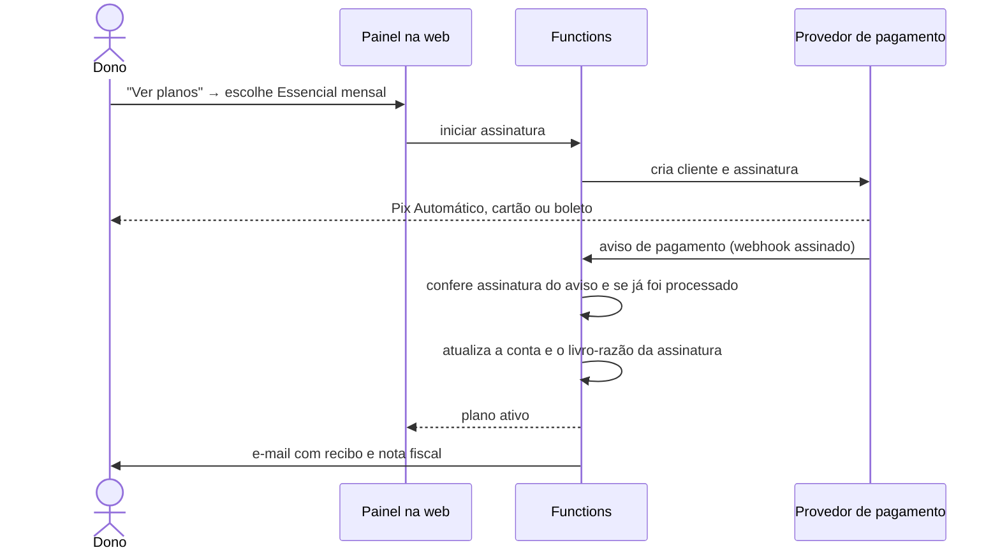

# 04 · Cobrança: pago pelos donos das quadras

Marcação: **[lido]** = está no código ou na documentação do repositório; **[fonte]** = página oficial consultada em 14/11/2026, com link; **[proposta]**; **[suposição]**; **[dúvida]** = depende de interpretação jurídica ou da revisão das lojas.

As regras das lojas estão **parafraseadas**, com o link da página. Antes de qualquer envio às lojas, releia o texto original: ele muda.

## 1. Princípio

- **O jogador e o organizador não pagam para usar.** São eles que dão valor à quadra.
- **A quadra paga pela ferramenta de trabalho** (agenda e caixa), não para aparecer na lista.
- **A venda acontece na web**, por Pix, cartão ou boleto, com nota fiscal. Os aplicativos não vendem o plano.
- **Os dados do dono nunca ficam reféns**: com o plano vencido ele continua vendo e exportando tudo.

## 2. O que é grátis e o que é pago

| | Grátis | Pago |
|---|---|---|
| **Jogador e organizador** | tudo: jogos, presença, times, ao vivo, votação, turmas, caixa e mensalidade da turma, ranking, conquistas, mapa de quadras, pedir horário | só o opcional "Sem anúncios" (seção 4) |
| **Quadra** | página no mapa, quadras, fotos, horário de funcionamento, receber jogos do app como hoje | agenda gerenciada, mensalistas, caixa, equipe, relatórios, lista de espera, pedidos de horário |

**Mudança em relação a hoje.** A regra atual é "o local só aparece para o jogador se estiver em dia" [lido: `docs/VENUE_MONETIZATION.md`, "Core Rule"]. Proponho inverter: aparecer é grátis, gerenciar é pago. Motivo: com poucos jogadores, "aparecer" vale pouco para o dono e muito para o app (mais quadras no mapa, mais motivo para o organizador usar). O que o dono paga com gosto é o que tira trabalho dele. É a decisão 1 do README.

## 3. Planos e limites sugeridos

Os códigos de plano já existem no servidor (`TRIAL`, `BASIC`, `PRO`, `ENTERPRISE`, `CUSTOM`), assim como a cobrança por número de quadras (`FIELD_COUNT`) [lido]. **Nenhum preço está definido em lugar nenhum** [lido]. O que segue é proposta.

| Plano | Para quem | Limites sugeridos | Faixa de preço a validar |
|---|---|---|---|
| **Vitrine** (grátis) | qualquer quadra | página, mapa, fotos, horários; sem agenda gerenciada e sem caixa | R$ 0 |
| **Essencial** | arena pequena, o dono atende | 1 arena, até 2 quadras, 2 pessoas na equipe, agenda completa, mensalistas, caixa no modo simples, relatórios básicos, exportação | R$ 49 a R$ 99 por mês |
| **Profissional** | arena com recepção | 1 arena, até 8 quadras, equipe sem limite com permissões, caixa por turno, todos os relatórios, lista de espera, pedidos de horário pelo app, Pix conciliado quando existir | R$ 129 a R$ 249 por mês |
| **Rede** | várias arenas | tudo do Profissional, relatórios consolidados | sob consulta; ponto de partida de R$ 99 a R$ 199 por arena |
| **Teste** | todos | 30 dias de Profissional, sem cartão [o prazo de 30 dias já existe no código] | R$ 0 |

Plano anual: desconto equivalente a dois meses [proposta].

**As faixas não são fato; são um ponto de partida com estas premissas:**

1. Uma hora de quadra society alugada custa algo entre R$ 100 e R$ 300 [suposição; não há dado: a auditoria de maio registra preço zero em todas as quadras cadastradas].
2. O plano deve custar **menos que uma ou duas horas de quadra por mês**, para a conta fechar na cabeça do dono sem planilha.
3. Não pesquisei o preço de concorrentes (sistemas de gestão de quadra no Brasil). Precisa ser feito antes de fixar preço.
4. Preço se descobre com gente: piloto com 5 a 10 arenas, de graça por 60 a 90 dias, e ao fim a pergunta direta "quanto isso vale para você?".

**Quanto dá, nesta escala** [suposição, só para dimensionar]: se uma arena tem de 20 a 60 turmas fixas por semana, com cerca de 15 jogadores cada, uma única arena ativa alcança de 300 a 900 jogadores. Mil usuários podem vir de duas a quatro arenas. Ou seja: a quadra é ao mesmo tempo o cliente e o melhor canal de aquisição de jogadores. Com 20 arenas pagantes a R$ 99, a receita é de cerca de R$ 2 mil por mês; o modelo só fica relevante com dezenas de arenas.

**Limites de plano são aplicados no servidor**, na hora do comando (criar a 3ª quadra, convidar a 3ª pessoa). A mensagem é direta: "Seu plano inclui 2 quadras. Veja os planos." Nunca se apaga nem se esconde o que já existe.

## 4. Anúncios e "Sem anúncios"

**Hoje** [lido]: faixa do AdMob nas abas principais, só depois da primeira vitória, sempre não personalizada; AdSense na web; assinatura "Sem anúncios" a R$ 9,90 por ano pelo Play e pela App Store, com o direito guardado só no aparelho, sem validação no servidor. As fichas das lojas foram revisadas hoje (#4550) e a política de privacidade 2.1 acabou de sair (#4553).

**Proposta**

| Tema | Recomendação | Por quê |
|---|---|---|
| Anúncios para o jogador | **manter por enquanto** | não há receita B2B ainda; desligar agora é abrir mão do pouco que entra sem nada no lugar |
| Onde nunca aparece anúncio | painel do dono, agenda, caixa, pagamento, erro (a política atual já veta essas rotas [lido]) e, novo: **página de arena pagante e fluxo de pedir horário nela** | é um benefício visível do plano: "na sua página não tem anúncio de ninguém" |
| "Sem anúncios" | **manter como está**; quem assinou continua sem anúncio | acabou de ser lançado; mexer agora gera retrabalho de loja |
| Validação no servidor | adiar | por R$ 9,90 ao ano o risco é baixo; vira necessário se o direito tiver de valer também na web |
| Ponto de revisão | quando a receita B2B passar, por três meses seguidos, de algumas vezes a receita de anúncios (o múltiplo é do Renan), decidir se os anúncios saem de vez | anúncio ao lado de um produto pago por empresas desvaloriza o produto |

**Se um dia os anúncios saírem de vez**: parar de vender "Sem anúncios" nas duas lojas, avisar quem assinou e não deixar ninguém pagando por algo que virou padrão. O procedimento exato de encerrar uma assinatura em cada console não foi verificado; conferir antes.

## 5. Como cobrar o plano da quadra

### 5.1 Comparação

| | **Web + provedor de pagamento brasileiro** | **Compra dentro do app (lojas)** |
|---|---|---|
| Formas de pagamento | Pix, Pix Automático, cartão, boleto | cartão e saldo da loja |
| Custo sobre R$ 99 [fonte: tabelas da seção 5.3 e 8] | Pix: cerca de R$ 1 a R$ 2; cartão: cerca de R$ 3,50 | Google: 15% (R$ 14,85); Apple no Brasil, para quem está no programa de pequenas empresas: 10% de comissão + 5% de processamento (R$ 14,85) |
| Nota fiscal para a empresa cliente | emitida pela TECHFERNANDES | a loja é quem vende; a nota não sai no nome da TECHFERNANDES |
| Cobrança em atraso | controlada por nós (carência, suspensão) | controlada pela loja |
| Quem costuma pagar | empresa, com CNPJ, muitas vezes no computador | pessoa física, no celular |
| Risco de política de loja | nenhum, se o app não vender nem apontar para a compra | nenhum |

**Recomendação: web, com provedor brasileiro.** É o caminho natural para cobrar empresa no Brasil e custa de 4 a 15 vezes menos por pagamento.

### 5.2 Fluxo proposto

- Reaproveita o que existe: conta comercial, estados (teste, ativa, em atraso, suspensa, cancelada), livro-razão imutável e a tarefa diária de ciclos [lido].
- Novo: integração com o provedor, recebimento dos avisos (com verificação de assinatura e de duplicidade), página de planos, troca de plano, cancelamento pelo próprio dono.
- O caminho manual (comprovante + conferência do admin) [lido] **continua como reserva** e é o que basta para o piloto: dá para começar a cobrar as primeiras arenas sem integração nenhuma.
- **Pix Automático** serve para cobrança recorrente com autorização única do pagador e está em funcionamento desde 16/06/2025 [fonte: [Banco Central](https://www.bcb.gov.br/estabilidadefinanceira/pix-automatico); data no [Relatório de Gestão do Pix](https://www.bcb.gov.br/content/estabilidadefinanceira/pix/relatorio_de_gestao_pix/relatorio_gestao_pix_2026.pdf)].

### 5.3 Provedores

Tarifas das páginas oficiais em 14/11/2026. Conferir antes de contratar; várias páginas mostram preço promocional.

| Provedor | Pix | Cartão à vista | Boleto | Assinatura | Divisão de pagamento e subcontas | Pix Automático |
|---|---|---|---|---|---|---|
| [Asaas](https://www.asaas.com/precos-e-taxas) | R$ 2,15 por cobrança (promocional menor nos 3 primeiros meses) | 2,99% + R$ 0,49 | R$ 2,15 | sim | sim | sim, por API ([documentação](https://docs.asaas.com/docs/pix-automatico)) |
| [Efí](https://sejaefi.com.br/tarifas) | 1,19% | 3,49% | R$ 3,45 | sim | sim, por API | sim (tarifa própria por Pix liquidado) |
| [Stripe](https://stripe.com/br/pricing) | 1,19%, só por convite | 3,99% + R$ 0,39 | R$ 3,45 | sim | sim | não disponível para empresa sediada no Brasil ([documentação](https://docs.stripe.com/payments/pix)) |
| [Mercado Pago](https://www.mercadopago.com.br/ferramentas-para-vender/check-out) | 0,99% | de 3,98% a 4,98%, conforme o prazo | cerca de R$ 3,49 a R$ 3,99 | sim | não confirmado na página | não achei |
| [Pagar.me](https://pagar.me) | 0,99% (em destaque promocional) | 4,19% | não achei | sim | sim | não achei |
| [Iugu](https://www.iugu.com/saiba-mais) | 0,99% | 3,34% + R$ 0,40 | R$ 2,19 + R$ 0,40 | sim | sim (com custo por subconta) | tem página do produto; tarifa não informada |

**Recomendação**: fazer um teste curto com **Asaas** e **Efí** (os dois têm assinatura, Pix Automático por API e subcontas, que serão necessárias se um dia o jogador pagar a quadra pelo app) e escolher por: qualidade dos avisos de pagamento, emissão de nota fiscal de serviço integrada, e facilidade de abrir subconta para a arena. Para um plano de R$ 99, Asaas (valor fixo) e Efí (percentual) ficam perto um do outro. Se o Asaas emite nota fiscal de serviço de forma integrada é algo que lembro, mas não confirmei nesta pesquisa. É a decisão 6 do README.

Segredos do provedor (chave de API, segredo do webhook): no Bitwarden, coleção `Apps e APIs`, e no Secret Manager das Functions; nunca no repositório.

## 6. Ciclo, atraso e suspensão

Reaproveita as constantes que já existem (carência de 5 dias, suspensão em 15, teste de 30) [lido]. Hoje o teste vencido é só contado, não muda nada [lido].

| Momento | O que o dono vê | O que muda |
|---|---|---|
| Teste, dia 1 a 20 | nada sobre pagamento | tudo liberado |
| Teste, dia 21 a 30 | "Seu teste termina em N dias." **Ver planos** (web) | nada |
| Fim do teste sem plano | "Seu teste acabou. Sua página continua no ar." | volta ao Vitrine: agenda e caixa ficam **só para leitura e exportação** |
| Plano ativo, pagamento em dia | nada | tudo do plano |
| Vencido, dia 1 a 5 (carência) | faixa discreta: "Não identificamos o pagamento deste mês." | nada |
| Vencido, dia 6 a 15 | aviso a cada entrada no painel + e-mail | nada |
| Vencido, dia 16 em diante (suspenso) | "Plano suspenso. Regularize para voltar a marcar horários." | **marcar, receber e lançar ficam desligados**; ver, exportar e a página pública continuam |
| Pagou | volta na hora | tudo do plano |
| Cancelou | confirmação e pesquisa de uma pergunta | vale até o fim do período pago; depois, Vitrine |

Regras:

1. **Nada é apagado por falta de pagamento.** Exportação completa sempre disponível.
2. **Reservas futuras já marcadas não somem** quando o plano é suspenso: a quadra continua tendo de honrá-las, e os clientes continuam vendo.
3. **Rebaixar de plano com excesso** (8 quadras no Profissional → Essencial com limite de 2): o dono escolhe quais quadras ficam com agenda gerenciada; as outras ficam em leitura.
4. **Sem cobrança surpresa**: troca de plano mostra o valor proporcional antes de confirmar.
5. **O aviso de atraso nunca aparece para o atendente nem para o cliente da quadra.** É assunto do dono.

## 7. O jogador pagar a quadra pelo app (fase posterior)

Não é pré-requisito do projeto. Se for feito:

- É pagamento de **serviço físico consumido fora do app** (o aluguel da quadra). Pelas regras das duas lojas, esse tipo de pagamento **não usa** a compra dentro do app (seção 8).
- Tecnicamente: cobrança Pix dinâmica pelo provedor, em **subconta da arena**, com baixa automática no caixa dela.
- **Não cobrar taxa do jogador** na primeira versão. Uma "taxa de serviço" do app em cima da reserva pode ser lida pelas lojas como venda digital [dúvida].
- **Perguntas regulatórias** [dúvida, para jurídico]: se a TECHFERNANDES, ao orquestrar pagamentos de terceiros por subcontas de um provedor, precisa de algum enquadramento próprio junto ao Banco Central; quem responde por estorno e fraude; e como fica o cadastro (conheça seu cliente) de cada arena. A premissa de trabalho é que o provedor, e não a TECHFERNANDES, guarda e movimenta o dinheiro.

## 8. O que a Apple e o Google exigem

### 8.1 Apple

Fontes: [App Review Guidelines](https://developer.apple.com/app-store/review/guidelines/) (a página informa atualização em 16/10/2026), [Mudanças no iOS no Brasil](https://developer.apple.com/support/app-distribution-in-brazil/), [Opções de pagamento na App Store no Brasil](https://developer.apple.com/support/payment-options-on-the-app-store-in-brazil/), [Programa para pequenas empresas](https://developer.apple.com/app-store/small-business-program/).

| Regra | O que diz, em resumo | O que significa aqui |
|---|---|---|
| 3.1.1 | liberar recurso ou funcionalidade dentro do app (assinatura, por exemplo) pede compra dentro do app | se o app do iPhone tiver recurso do dono liberado por um plano pago, essa é a regra de partida |
| 3.1.1(a) | fora dos Estados Unidos, o app e a ficha não podem ter botão, link ou chamada para outra forma de compra, salvo com a permissão regional prevista | sem link "assine no site" no app do iPhone, a não ser pelo caminho do Brasil, abaixo |
| 3.1.3 (abertura) | o desenvolvedor pode falar com seus usuários **fora do app** sobre outras formas de compra | e-mail e site podem vender o plano |
| 3.1.3(b) Serviços multiplataforma | o app pode dar acesso ao que foi comprado em outra plataforma, desde que o item **também** seja oferecido como compra dentro do app | liberar no iPhone um plano comprado na web, sem oferecê-lo também na loja, contraria a leitura literal |
| 3.1.3(c) Serviços para empresas | app vendido **diretamente a organizações**, para seus funcionários, pode dar acesso ao que foi contratado fora; venda a consumidor ou a usuário individual pede compra dentro do app | é o encaixe mais próximo do plano da quadra |
| 3.1.3(e) Bens e serviços fora do app | bem ou serviço físico consumido fora do app **deve** usar outro meio que não a compra dentro do app | aluguel de quadra pago pelo jogador fica fora da compra dentro do app |
| 3.1.3(a), (d), (f) | leitura, serviço entre duas pessoas em tempo real, e app gratuito de certos serviços (voz, armazenamento, e-mail, hospedagem) | não se aplicam |

**Brasil, desde o iOS 26.5** [fonte: as duas páginas de suporte acima]: por acordo com o CADE, o desenvolvedor pode usar processador de pagamento alternativo dentro do app e fazer ofertas para compra fora do app, com ou sem link. Condições: exige a permissão específica do StoreKit; a compra dentro do app da Apple tem de ser apresentada **ao mesmo tempo e com o mesmo destaque**; há telas de aviso obrigatórias; e é preciso enviar à Apple relatório mensal das transações. Comissões para quem está no programa de pequenas empresas: 10% na compra dentro do app, mais 5% de processamento; 10% no processador alternativo; 10% sobre vendas feitas em até 7 dias depois do toque em um link. A ficha do app na loja não pode falar de compra no site.

### 8.2 Google Play

Fontes: [política de Pagamentos](https://support.google.com/googleplay/android-developer/answer/9858738), [Entendendo a política de Pagamentos](https://support.google.com/googleplay/android-developer/answer/10281818), [taxas de serviço](https://support.google.com/googleplay/android-developer/answer/112622), [faturamento por escolha do usuário](https://support.google.com/googleplay/android-developer/answer/13821247).

| Regra | O que diz, em resumo | O que significa aqui |
|---|---|---|
| O que exige o faturamento do Play | item digital, assinatura, funcionalidade do app e **software e serviço em nuvem, incluindo produtividade para empresas e gestão financeira** | um plano de gestão de quadra **vendido dentro do app Android** cai na regra |
| O que não usa o faturamento do Play | bem físico e **serviço físico** (a página cita transporte e mensalidade de academia) | aluguel de quadra fica fora |
| Direcionamento | o app não pode levar o usuário a outro meio de pagamento (botão, link, página embutida) | sem link de compra no app Android |
| App só de consumo | qualquer app pode ser só de consumo, mesmo sendo parte de um serviço pago; pode-se comunicar fora do app | o dono pode **usar** no Android o que contratou na web, sem o app vender |
| Consumo fora do app | item digital que só se consome fora do app distribuído pelo Play não exige o faturamento do Play | um painel só na web está fora da regra |
| Programas no Brasil | o faturamento por escolha do usuário inclui o Brasil para apps que não são jogos; os programas de oferta e link externos não incluem o Brasil | dá para oferecer pagamento alternativo ao lado do Play, com taxa reduzida; não dá para apontar link de compra |
| Taxa | 15% para assinatura com renovação automática; 15% sobre o primeiro US$ 1 milhão por ano nos demais casos | referência para a comparação da seção 5.1 |

### 8.3 Opções para o lado do dono nos aplicativos

| # | Opção | Apple | Google | Avaliação |
|---|---|---|---|---|
| 1 | **Painel do dono só na web** (página instalável no celular); os apps ficam para jogador e organizador | fora do alcance das regras de compra | fora do alcance | **mais segura; recomendada para começar** |
| 2 | Modo dono dentro dos apps atuais, sem preço, sem botão e sem link de compra | depende de a revisão aceitar a leitura de 3.1.3(c) num app que também é de consumidor [dúvida] | permitido como "só de consumo", com a dúvida de o mesmo app já vender "Sem anúncios" pelo Play [dúvida] | viável no Android; arriscada no iPhone |
| 3 | **App separado para quadras** ("Futeba Quadras"), só para a equipe das arenas | é onde 3.1.3(c) se encaixa melhor: app vendido só a organizações | só de consumo, sem ambiguidade | boa segunda etapa, quando houver demanda por app nativo do dono |
| 4 | Vender o plano também como compra dentro do app | permitido (3.1.3(b)) | permitido | custo de 15% e nota fiscal fora do nosso nome; não recomendo |
| 5 | Usar as opções do Brasil no iPhone (link ou processador alternativo) | permitido com a permissão, a compra da Apple ao lado, comissão e relatório mensal | não há equivalente de link | complexidade desproporcional nesta escala |

**Recomendação**: começar pela opção 1. O que hoje existe do dono nos apps (cadastro de local e quadra no Android [lido]) fica como está: gratuito e sem relação com plano. Passar à opção 3 quando o piloto mostrar que o dono quer app nativo. A opção 2 só com uma consulta prévia à revisão da Apple ou com precedente claro.

**O que pode aparecer em cada lugar** (opção 1):

| | Web | App Android | App iPhone | E-mail e WhatsApp |
|---|---|---|---|---|
| Preço do plano | sim | não | não | sim |
| Botão ou link para assinar | sim | não | não | sim |
| Frase "gerencie sua quadra em futebadosparcas.com.br/quadras", sem link de compra | sim | cautela: só texto informativo, sem falar de preço [dúvida] | evitar [dúvida] | sim |
| Aviso de plano vencido | sim | não | não | sim |
| Pagamento de aluguel de quadra pelo jogador (fase posterior) | sim | sim, fora do faturamento do Play | sim, fora da compra da Apple | n/a |
| "Sem anúncios" | não se vende | Play | App Store | n/a |

## 9. Fiscal e proteção de dados

- **Nota fiscal de serviço.** Empresa do Simples Nacional deve emitir documento fiscal da prestação de serviço [fonte: [LC 123/2006, art. 26, I](https://www.planalto.gov.br/ccivil_03/leis/lcp/lcp123.htm)]. Licenciamento de uso de programa e processamento de dados estão na lista de serviços da [LC 116/2003](https://www.planalto.gov.br/ccivil_03/leis/lcp/lcp116.htm). O subitem e a alíquota dependem do contador e do município [dúvida]. Consequência prática: cada pagamento de plano gera nota; isso precisa estar no processo desde a primeira arena pagante.
- **LGPD.** Para os dados dos clientes da quadra (nome, telefone, o que devem), a quadra decide o tratamento e a TECHFERNANDES o executa em nome dela: pela [Lei 13.709/2018](https://www.planalto.gov.br/ccivil_03/_ato2015-2018/2018/lei/l13709.htm), arts. 5º (VI e VII) e 39, isso aponta para quadra **controladora** e TECHFERNANDES **operadora**. O papel depende da atuação concreta: se o app usar esses dados para fins próprios (anúncios, análises), passa a ser controlador também [dúvida]. Consequências: contrato de tratamento de dados nos termos do plano, política de privacidade atualizada, e **nunca** usar dados de clientes da quadra para anúncio.
- **Termos do plano**: contrato de adesão para empresas (preço, reajuste, cancelamento, suspensão, portabilidade dos dados, limites de responsabilidade). Texto jurídico; não é para ser escrito por agente.

## 10. Dúvidas de interpretação (para decidir com quem entende)

1. **Apple 3.1.3(c)**: dono de quadra pessoa física ou MEI conta como "organização"? E um app que serve jogador e dono ao mesmo tempo pode se apoiar nessa regra?
2. **Apple 3.1.3(b)**: dar acesso no iPhone a um plano comprado na web sem oferecê-lo também na loja.
3. **Apple no Brasil**: oferta para fora do app **sem** link clicável exige a permissão; a comissão está descrita para o link clicável. Não está claro o que incide no caso sem link.
4. **Google**: o app já vende "Sem anúncios" pelo Play; isso impede tratá-lo como "só de consumo" para o plano da quadra?
5. **Google**: o painel dentro do app Android é "software de produtividade para empresas", mesmo vendido só na web. A regra do app só de consumo cobre, mas a leitura é da revisão.
6. **Taxa de serviço sobre aluguel de quadra**: físico ou digital?
7. **Banco Central**: enquadramento da TECHFERNANDES ao orquestrar pagamentos por subcontas.
8. **ISS**: subitem e alíquota do plano.
9. **LGPD**: operador puro ou controlador conjunto.

## 11. Não verificado

- Preço de concorrentes e disposição de pagar dos donos.
- Preço médio da hora de quadra.
- Data exata e texto do acordo com o CADE (li as páginas de suporte da Apple, não o acordo).
- Datas de atualização das páginas do Google Play, do programa de pequenas empresas da Apple e dos provedores (não informam).
- Detalhes dos provedores marcados como "não achei" ou "não confirmado"; emissão de nota fiscal integrada; custo de subconta.
- Procedimento, em cada console, para encerrar a venda de uma assinatura existente.
- Receita atual de anúncios e número de assinantes de "Sem anúncios".
