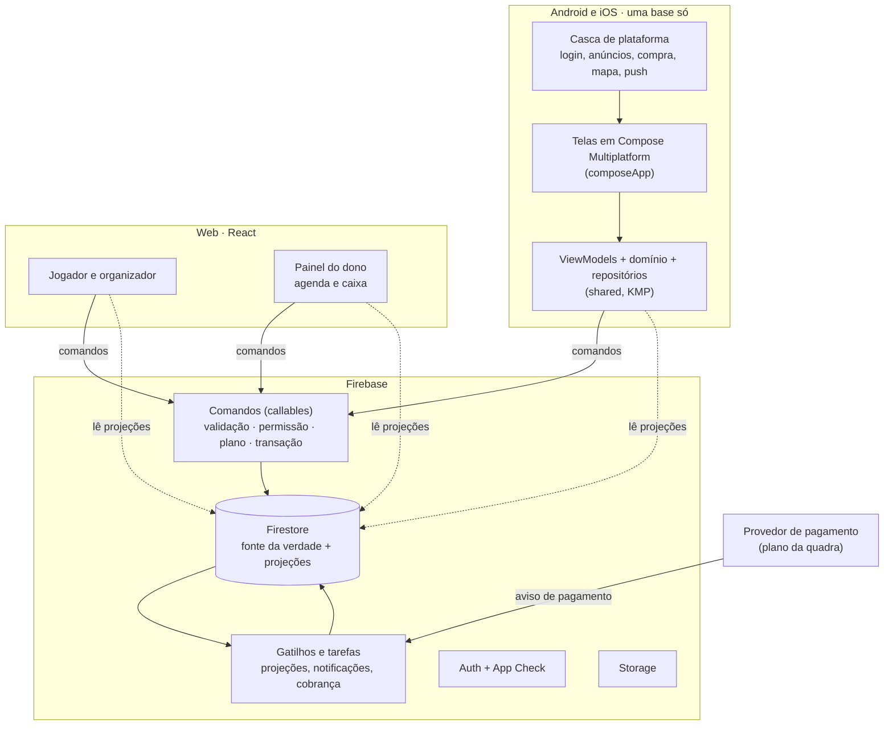
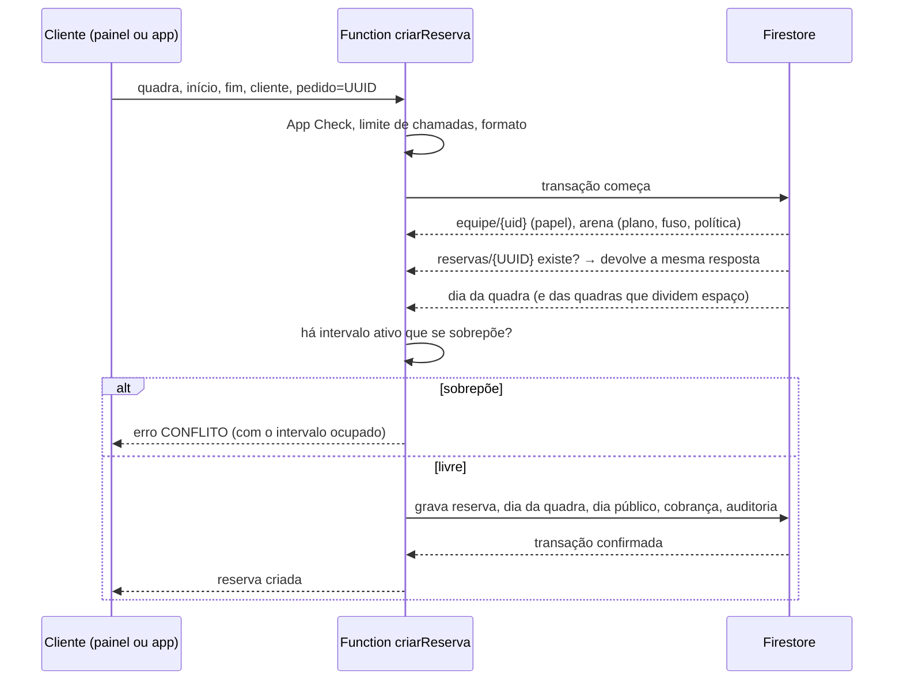
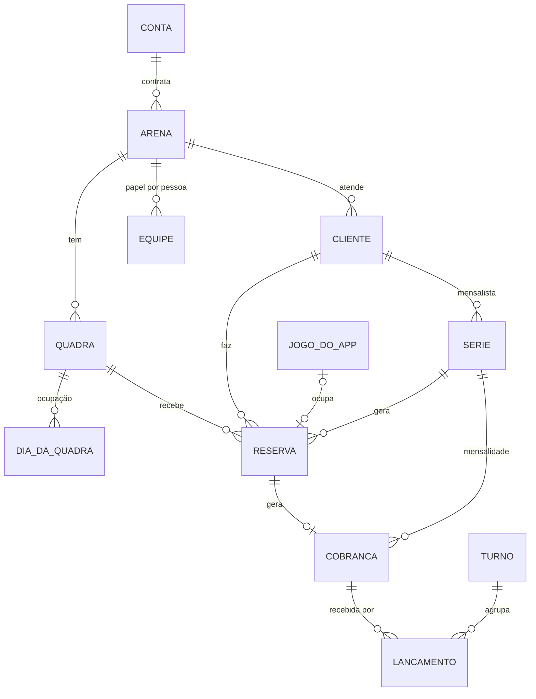

# 05 · Arquitetura-alvo e dados

Marcação: **[lido]** = existe hoje (fonte no `01-diagnostico.md`); o resto é **proposta**. Números de custo são **estimativas com premissas explícitas**, não medição.

## 1. Objetivos e restrições

**Objetivos**

1. Uma regra de negócio mora em um lugar só.
2. Uma funcionalidade nova é escrita no máximo duas vezes (celular e web), não três ou quatro.
3. Agenda sem dupla marcação e caixa que fecha, garantidos pelo servidor.
4. Aguentar 1.000 usuários com folga e 10.000 sem redesenho.
5. Poder mudar regra de negócio sem publicar app novo.

**Restrições da empresa**

- Sem GitHub Actions pago: testes rodam localmente, no pre-push, e no runner próprio que já existe.
- Segredos só no Bitwarden (e no Secret Manager das Functions, alimentado a partir dele); nada no repositório.
- Nenhum agente ou tarefa agendada de agente em segundo plano sem autorização. As tarefas agendadas deste documento são Cloud Functions do produto, não agentes; mesmo assim estão listadas na seção 6.3 para o Renan ver o que nasceria.
- Uma pessoa mantém tudo. Arquitetura que exige plantão não serve.

## 2. Alternativas e recomendação

| | **A · "Chata": manter Firebase e reorganizar** | **B · Híbrida: Firebase + banco relacional para agenda e caixa** | **C · Reescrever** (outra pilha de app ou de servidor) |
|---|---|---|---|
| O que muda | modelo novo dentro do Firestore; toda escrita de agenda e de dinheiro por Functions em transação; um domínio só nos clientes | agenda e caixa em Postgres (restrição de exclusão para intervalos, relatórios em SQL); o resto fica no Firebase | tudo |
| Dupla marcação | resolvida por transação sobre o documento do dia da quadra (seção 5.2) | resolvida pelo próprio banco | depende |
| Relatórios | documentos de resumo mantidos pelo servidor + consultas de agregação | SQL livre | depende |
| Custo fixo mensal | perto de zero nesta escala | um banco gerenciado ligado o mês inteiro, mais a ponte entre os dois mundos | alto |
| Operação | a que já existe | dois bancos, duas cópias de segurança, dois modelos de permissão | tudo novo |
| Risco | baixo; incremental | médio; consistência entre dois bancos | alto; meses com duas bases |
| O que se perde | relatório improvisado em SQL | simplicidade | o que já está publicado e testado |

**Recomendação: A.** Motivos:

- O que falta hoje não é tecnologia; é uma regra (ninguém confere o horário) e um modelo (não existe reserva). As duas coisas cabem no Firestore com transação.
- O padrão certo já existe no próprio repositório: o caixa do grupo é gravado só pelo servidor, em transação, com identificador de pedido [lido]. É copiar o molde.
- Nesta escala o Firebase custa dezenas de dólares por mês (seção 12). Um banco gerenciado custaria mais que isso parado.
- A decisão de pilha de 04/11 (manter KMP + Compose Multiplatform + React) continua valendo.

**Como A não vira beco sem saída.** Os clientes nunca gravam agenda nem dinheiro: mandam **comandos** às Functions e leem **projeções** (o documento do dia, o resumo do caixa). Se um dia a fonte da verdade da agenda e do caixa precisar ir para um banco relacional, troca-se o que está atrás das Functions; as telas continuam lendo as mesmas projeções.

**Sinais para reavaliar e ir para B**: mais de algumas centenas de arenas ativas; necessidade recorrente de relatório que os resumos não atendem; integração contábil que exige SQL; ou disputa de escrita no documento do dia de uma quadra (muitas marcações por segundo no mesmo dia e na mesma quadra, o que não é o perfil de uma arena).

## 3. Visão geral



Três regras de desenho:

1. **Escrever é comando; ler é projeção.** Tudo o que envolve agenda, dinheiro, permissão ou plano é gravado por Function. O cliente escuta documentos prontos para a tela.
2. **O servidor é a única fonte de "agora", de preço, de permissão e de limite de plano.**
3. **Todo comando leva um identificador de pedido** gerado no cliente e pode ser repetido sem efeito duplo.

## 4. Clientes: quanto compartilhar

### 4.1 Celular: de duas bases para uma

Hoje o Android tem 65 ViewModels e 45 destinos em `app/`, e o iOS tem 9 ViewModels e 26 rotas em `composeApp/` [lido]. Proposta de estado final:

| Camada | Onde fica | Compartilhado entre Android e iOS |
|---|---|---|
| Modelos de domínio | `shared/.../domain/model` (os 97 de `app/.../data/model` e o `ModelMappers.kt` deixam de existir) | 100% |
| Regras e casos de uso | `shared/.../domain` | 100% |
| Repositórios e acesso ao Firebase | `shared/.../data` (uma pilha só; sai a de `app/.../data/datasource`) | 100% |
| ViewModels | `shared` (ViewModel multiplataforma) | 100% |
| Telas | `composeApp/commonMain` | meta: mais de 90% |
| Sistema de design e textos | `composeApp/commonMain` (recursos multiplataforma) | 100% |
| Casca | `app/` (Android) e `iosApp/` (Swift) | 0%: login do sistema, AdMob, Play Billing e StoreKit, mapa, push, câmera |
| Banco local | um só. Room e SQLDelight juntos não fazem sentido; decidir por SQLDelight (já é multiplataforma) ou só pelo cache do Firestore | 100% |

**Sem multiplicar módulos Gradle.** Ficam os três que existem (`shared`, `composeApp`, `app`), organizados em pacotes por funcionalidade. Dividir em mais módulos só se o tempo de compilação pedir.

**A direção da convergência importa.** As telas maduras são as do Android. O caminho é **levar as telas do Android para o código comum**, fluxo a fluxo, e o iOS passa a usá-las; não é fazer o Android adotar as telas mais magras do iOS. Cada fluxo migrado entra atrás de uma flag do Remote Config, com o caminho antigo ligado por padrão (regra 7 do `PLANO.md` de 04/11).

**O que custa caro nessa migração** (para não vender facilidade):

- Cerca de 4 mil textos em `strings.xml` têm de ir para recursos multiplataforma [o número vem do `PLANO.md`, D18].
- Dependências só de Android dentro das telas (mapa, login do sistema, câmera) viram interfaces com implementação por plataforma.
- 41 arquivos acima de 800 linhas [lido] precisam ser quebrados no caminho.
- É o maior item do plano (tamanho GG). Por isso segue a ordem do produto: onboarding e Jogos primeiro, que seriam redesenhados de qualquer forma (`02`), e assim são reescritos uma vez só, já no lugar certo.

**Rede de proteção**: `verify()` do Koin sobre todos os módulos, em teste, para Android e para o grafo do `composeApp`. Acaba a classe de erro dos PRs #4551 e #4552. Sai o `koinInjectOrNull` com tela "indisponível", que esconde o problema [lido].

### 4.2 Web

- Continua em React. É a plataforma mais completa e a única que o `shared` não alcança (sem alvo JS [lido]).
- O **painel do dono nasce na web**, responsivo e instalável no celular. É onde o dono trabalha (computador da recepção, tablet) e é o que deixa a cobrança fora das regras das lojas (`04`, seção 8.3).
- A web para de reimplementar regra: valida no cliente só para dar resposta rápida; a decisão é do comando.

### 4.3 Uma regra, um lugar

| Tipo de regra | Onde mora | Como os clientes ficam alinhados |
|---|---|---|
| Dinheiro, agenda, permissão, plano, XP, liga, conquistas | Functions (TypeScript) | os clientes só chamam e exibem |
| Regra que precisa rodar no aparelho (sorteio de times, prévia de recorrência, proporcional da mensalidade na tela) | uma implementação em Kotlin (`shared`) e uma em TypeScript (web e Functions) | **casos de teste em JSON compartilhados**: os dois lados têm de dar o mesmo resultado para a mesma entrada. É o padrão que já existe com `shared/xp-constants.json` e `shared/badges-catalog.json` [lido] |
| Formato dos comandos (entrada e saída) | um esquema por comando, no repositório das Functions | tipos TypeScript gerados para a web; exemplos em JSON validados nos testes do `shared` |

**Compilar o `shared` para JavaScript** e usá-lo na web e nas Functions resolveria a duplicação de vez, mas traz risco de tamanho de pacote e de ergonomia. Fica como experimento curto e opcional na Fase 1; nada depende dele.

## 5. Dados

### 5.1 Princípios

1. **Aditivo.** `locations` e `fields` continuam sendo a arena e a quadra, com os mesmos identificadores [lido]. O módulo novo entra como subcoleções. Nenhuma coleção existente é renomeada.
2. **Centavos inteiros** para todo valor.
3. **Instante em UTC + data local + minutos do dia** em tudo o que é agenda.
4. **Dinheiro e auditoria só acrescentam.** Não há atualização nem exclusão.
5. **Projeções são descartáveis.** Podem ser reconstruídas a partir da fonte da verdade por um script.
6. **Dado pessoal de cliente da quadra fica dentro da arena**, visível só à equipe dela.

### 5.2 Reserva sem dupla marcação

A fonte da verdade da ocupação é **um documento por quadra e por dia**, com a lista de intervalos ocupados. Marcar é uma transação que lê esse documento, confere a sobreposição e grava.



Por que funciona:

- Duas transações que leem o mesmo documento do dia não confirmam as duas: o Firestore refaz a segunda, que então enxerga o intervalo da primeira e devolve conflito.
- **Uma leitura mostra o dia inteiro de uma quadra.** A grade do dia de uma arena com 6 quadras custa 6 leituras; a semana, 42.
- Reserva que atravessa a meia-noite toca dois documentos; quadra que divide espaço toca os das quadras em conflito. Tudo na mesma transação.
- **Mover** é liberar e ocupar na mesma transação. **Série de mensalista** confere as ocorrências da janela (13 semanas) e grava todas, ou devolve a lista de conflitos sem gravar nada.
- O identificador da reserva é o identificador do pedido: repetir o comando não cria outra.

Limites conhecidos: um documento tem até 1 MiB (um dia de uma quadra tem dezenas de intervalos, não milhares) e uma transação tem até 500 escritas (uma série de 13 ocorrências usa algumas dezenas).

**Verificador de invariantes** (tarefa noturna, só relata): procura intervalos ativos sobrepostos por quadra e diferença entre lançamentos e resumos. O número esperado é zero; se não for, alerta.

### 5.3 Coleções



| Caminho | Situação | Conteúdo | Quem lê | Quem grava |
|---|---|---|---|---|
| `venue_accounts/{id}` | existe | plano, estado, ciclo | dono, admin | Functions |
| `locations/{arena}` | existe | + agenda gerenciada, grade, modo de caixa, política de cancelamento | como hoje | dono e gerente nos campos não comerciais (como hoje); o resto, Functions |
| `locations/{arena}/private/settings` | novo | chave Pix da arena, pontos de caixa, padrões | equipe | Functions |
| `.../fields/{quadra}` | existe | + coberta, quadras em conflito, faixas de preço | como hoje | como hoje |
| `.../staff/{uid}` | novo (substitui `managers[]`) | papel, ajustes de permissão, estado | a própria pessoa, dono, gerente | Functions |
| `.../manager_invites/{id}` | existe | convite com papel | como hoje | Functions |
| `.../customers/{id}` | novo | nome, telefone, vínculo opcional com conta ou turma, crédito, faltas, arquivado | equipe | Functions |
| `.../bookings/{id}` | novo | tipo (avulso, mensalista, jogo do app, bloqueio), estado, quadra, início e fim, data local, cliente, série, jogo, valor, origem | equipe; o próprio cliente, quando tem conta | Functions |
| `.../agenda_days/{quadra_data}` | novo | intervalos com rótulo, tipo, estado e sinal de pago. **É a trava de conflito e a leitura da grade** | equipe | Functions |
| `.../agenda_public/{quadra_data}` | novo | só início e fim dos intervalos ocupados, sem nomes | qualquer usuário autenticado | Functions |
| `.../series/{id}` | novo | cliente, quadra, dia da semana, hora de parede, duração, frequência, início, fim, valor, modo de cobrança, pausas, "gerado até" | equipe | Functions |
| `.../waitlist/{id}` | novo | cliente, horário ou faixa, posição, estado, prazo | equipe; o próprio | Functions |
| `.../charges/{id}` | novo | cliente, origem, competência, vencimento, valor, pago, estado, ajustes | conforme papel | Functions |
| `.../cash_entries/{id}` | novo | entrada ou saída, valor, forma, categoria, quadra, cliente, cobrança, turno, ponto de caixa, data a que se refere, estorno de, estornado por | conforme papel | Functions |
| `.../cash_sessions/{id}` | novo | ponto de caixa, abertura, fundo, fechamento, esperado, contado, diferença, justificativa, forçado, visto | conforme papel | Functions |
| `.../cash_days/{data}` | novo (projeção) | totais por forma, quadra e categoria | conforme papel | Functions |
| `.../month_locks/{mes}` | novo | mês travado, por quem | equipe | Functions |
| `.../audit_logs/{id}` | existe | acrescenta os eventos de agenda e caixa | dono, gerente, financeiro | Functions |
| `.../availability/{id}` | existe, sem uso [lido] | **remover** a regra | | |
| `subscription_payments`, `subscription_ledger`, `commercial_events` | existem | + origem "provedor" e identificador do aviso | como hoje | Functions |
| `games/{id}` | existe | + `booking_id`, quando a arena tem agenda gerenciada | como hoje | criação em arena gerenciada passa a ser comando |

Identificador do documento do dia: `{quadra}_{AAAAMMDD}` na data local da arena.

### 5.4 Caixa e fechamento em transação

- **Receber** (uma transação): confere papel, turno aberto (no modo por turno) e mês não travado; lê a cobrança; grava o lançamento; atualiza a cobrança (pago e estado), o crédito do cliente (se houve excedente), o sinal de pago no documento do dia, o resumo do dia e a auditoria.
- **Estornar**: grava o lançamento inverso, marca o original como estornado, reabre a cobrança, ajusta o resumo. Recusa se já foi estornado.
- **Fechar turno**: lê o turno; calcula o dinheiro esperado a partir de um acumulador mantido no próprio turno (cada lançamento em dinheiro o atualiza na mesma transação, para não ter de somar centenas de documentos no fechamento); grava contado, diferença e justificativa; impede novos lançamentos naquele turno.
- **Travar mês**: grava a trava; todo comando de dinheiro confere a trava do mês a que o lançamento se refere.

### 5.5 Índices

O módulo novo precisa de poucos índices compostos, porque a grade lê por identificador e os relatórios leem resumos. Previstos: reservas por cliente e data; cobranças por estado e vencimento; cobranças por cliente e estado; lançamentos por turno; lançamentos por data de referência; séries ativas por "gerado até"; espera por horário e posição. É cerca de uma dezena, contra os 177 de hoje [lido].

### 5.6 Regras de segurança por papel

Esboço (a forma final vai com testes de regra, um por célula da tabela de permissões do `03`, seção 5.10):

```
match /locations/{arena} {
  function papel() {
    return get(/databases/$(database)/documents/locations/$(arena)/staff/$(request.auth.uid)).data.role;
  }
  function daEquipe() {
    return exists(/databases/$(database)/documents/locations/$(arena)/staff/$(request.auth.uid));
  }

  match /agenda_days/{d}    { allow read: if daEquipe();          allow write: if false; }
  match /agenda_public/{d}  { allow read: if request.auth != null; allow write: if false; }
  match /bookings/{b}       { allow read: if daEquipe() || resource.data.customer_uid == request.auth.uid;
                              allow write: if false; }
  match /customers/{c}      { allow read: if daEquipe();          allow write: if false; }
  match /cash_entries/{e}   { allow read: if papel() in ['OWNER','MANAGER','FINANCE']
                                        || (papel() == 'ATTENDANT' && resource.data.created_by == request.auth.uid);
                              allow write: if false; }
  match /cash_days/{d}      { allow read: if papel() in ['OWNER','MANAGER','FINANCE']; allow write: if false; }
  match /audit_logs/{a}     { allow read: if papel() in ['OWNER','MANAGER','FINANCE']; allow write: if false; }
}
```

- **Nenhuma escrita de cliente** em agenda, dinheiro, equipe ou auditoria. A regra de escrita é uma linha: `false`.
- Custo: uma leitura do documento de equipe por avaliação.
- O papel global `FIELD_OWNER` por *claim* [lido] continua para "pode criar arena". O papel dentro de cada arena vem do documento de equipe; *claims* não comportam várias arenas com papéis diferentes.
- Acesso de suporte do admin a dados de uma arena também gera registro de auditoria.

### 5.7 Várias arenas

Conta → arenas → quadras. A equipe é por arena. O painel tem um seletor de arena no topo quando a pessoa pertence a mais de uma. Relatório consolidado (plano Rede) lê os resumos de cada arena; nenhuma consulta cruza arenas no cliente.

## 6. Functions

### 6.1 Comandos novos (callables, todos com App Check, limite de chamadas e identificador de pedido)

| Área | Comandos |
|---|---|
| Arena e equipe | criar arena (autoatendimento), atualizar configuração, convidar pessoa, mudar papel, remover pessoa, pedir confirmação de titularidade, reivindicar arena existente |
| Agenda | criar reserva, mover, cancelar, marcar falta, bloquear, criar série, encerrar série, pausar série, criar exceção, entrar na espera, responder à espera |
| Pedido do jogador | pedir horário, aprovar, recusar |
| Caixa | receber, estornar, lançar despesa, sangria, suprimento, abrir turno, fechar turno, fechar à força, travar mês, reabrir mês, ajustar cobrança, combinar nova data |
| Relatórios | gerar exportação (CSV e PDF) |
| Plano | iniciar assinatura, trocar plano, cancelar |

### 6.2 Gatilhos

- Aviso de pagamento do provedor (HTTP, com verificação de assinatura e de duplicidade) → conta e livro-razão.
- Reserva criada ou alterada → notificações.
- Jogo criado, alterado ou cancelado em arena gerenciada → mantém a reserva ligada.

**Aliviar o que existe**: `games/{id}` tem 11 gatilhos por escrita [lido]. Juntar em um despachante que decide o que rodar a partir do que mudou no documento reduz invocações e partidas a frio. Não é urgente pelo custo; é pelo ruído e pela dificuldade de entender o que roda.

### 6.3 Tarefas agendadas que nasceriam (para ciência e autorização do Renan)

| Tarefa | Frequência | O que faz |
|---|---|---|
| Estender séries | diária | gera as ocorrências que entram na janela de 90 dias |
| Gerar mensalidades | diária | cria as cobranças do mês 5 dias antes do vencimento (identificador determinístico: não duplica) |
| Expirar pedidos e prazos da espera | a cada 15 minutos | libera horários não respondidos |
| Verificador de invariantes | diária | só relata |
| Ciclo do plano | já existe [lido] | passa a tratar o fim do teste |

Já existem 32 tarefas agendadas [lido]. Vale aproveitar para revisar duas: a que roda **a cada minuto** para enviar notificações (pode virar gatilho de fila) e a `testGameReminders`, de teste, implantada em produção [lido].

### 6.4 Latência

`maxInstances: 10`, sem `minInstances` [lido]. Para os comandos do balcão (criar reserva, receber), manter uma instância aquecida evita espera de partida a frio. Tem custo fixo mensal por instância, a calcular na calculadora do Google Cloud antes de ligar [não verificado]. Agrupar os comandos do painel em poucas funções ajuda mais que aquecer muitas.

## 7. Sem conexão

| Operação | Sem internet |
|---|---|
| Ver jogos, turmas, agenda e caixa já carregados | funciona (cache do Firestore; no iOS, confirmar que a persistência está ligada [não verificado]) |
| Confirmar presença | fila local com identificador de pedido; envia ao voltar; a tela mostra "Enviando…" e depois o resultado real (pode ser lista de espera) |
| Marcar, mover ou cancelar horário | **não permite**; mostra por quê |
| Receber pagamento | primeira versão: não permite. Depois, se o piloto pedir: fila de recebimentos com identificador de pedido, marcados como "a enviar", só para dinheiro e só no modo por turno |
| Partida ao vivo | cronômetro local (como hoje [lido]); eventos em fila com identificador |

Agenda e dinheiro não aceitam "otimismo": é melhor um aviso claro do que uma promessa que o servidor desfaz depois.

## 8. Notificações

| Para quem | Evento | Canal |
|---|---|---|
| Jogador | jogo mudou, vaga abriu, time sorteado, votação aberta (como hoje) | push |
| Jogador | pedido de horário aprovado ou recusado; quadra cancelou o horário | push |
| Equipe da arena | novo pedido de horário; cancelamento em cima da hora; vaga da espera aceita | push da web (painel instalado) e sino dentro do painel |
| Dono | turno aberto há mais de 18 horas; fechamento com diferença; três faltas seguidas de um mensalista | push da web e e-mail |
| Dono | teste terminando, pagamento não identificado, plano suspenso | **só e-mail e painel na web** (nunca dentro dos apps; `04`, seção 8.3) |
| Cliente da quadra sem conta no app | lembrete de pagamento | manual: o atendente abre o WhatsApp com o texto pronto |

Regras: toda notificação tem um motivo que a pessoa reconhece; preferência por tipo (já existe `notification_settings` [lido]); nenhum envio em massa.

## 9. Privacidade e dados pessoais

- **Papéis** (ver `04`, seção 9): para os clientes da quadra, a quadra decide e a TECHFERNANDES executa. O contrato do plano precisa dizer isso.
- **Minimização**: de cliente da quadra guarda-se nome e telefone. Sem CPF, sem endereço, sem data de nascimento.
- **Isolamento**: `customers` fica dentro da arena; só a equipe lê; nenhuma consulta entre arenas.
- **Sem dado pessoal em log**: registros estruturados levam identificadores, não nomes nem telefones.
- **Direitos do titular**: exportar e apagar os dados de um cliente são comandos do painel (a arena atende o pedido; a TECHFERNANDES executa). Apagar um cliente com histórico financeiro troca o nome e o telefone por um marcador e mantém os valores, para o caixa continuar fechando.
- **Vínculo com conta do app**: só com ação do próprio jogador (aceitar "A Arena X quer ligar seus horários à sua conta").
- **Nunca** usar dado de cliente de quadra para anúncio ou para perfil de jogador.
- **Pendência herdada**: o comentário de `firestore.rules:164-168` tem e-mails de pessoas [lido]. Remover.
- A política de privacidade e os termos precisam cobrir o módulo antes do piloto. É texto jurídico.

## 10. Observabilidade

- **Registro estruturado em todo comando**: nome do comando, arena, papel, identificador de pedido, resultado, duração. (90 arquivos das Functions já usam o `logger` [lido].)
- **Métricas novas**: conflitos recusados, taxa de erro por comando, latência (p50 e p95), avisos de pagamento rejeitados, invariantes violados, turnos abertos há mais de 18 horas.
- **Alertas** no `monitoring/manifest.json` que já existe [lido]: erro acima de um limite por 10 minutos, aviso de pagamento falhando, invariante diferente de zero.
- **Metas de serviço iniciais** [suposição]: criar reserva e receber em até 1,5 s no p95; dupla marcação igual a zero; app sem travar em 99,5% das sessões.
- **Funil de produto** no Analytics: os marcos do `02` (seções 4 e 5.3) viram eventos com nomes fixos.
- **Custo**: orçamento e alerta no Google Cloud (os valores de US$ 10/50/200 estão documentados [lido]; confirmar que existem).

## 11. Testes e CI local

| Camada | O que testar | Onde roda |
|---|---|---|
| Regras de agenda (sobreposição, meia-noite, quadra dividida, série, exceções) | testes de unidade com casos gerados (intervalos aleatórios) + casos fixos em JSON | pre-push |
| Concorrência | N comandos simultâneos para o mesmo horário → exatamente um sucesso (emulador) | runner próprio |
| Caixa (proporcional, crédito, estorno único, turno, mês travado) | unidade + emulador; propriedade: soma dos lançamentos = resumo | pre-push e runner |
| Regras de segurança | uma asserção por célula da tabela de papéis; nenhuma escrita de cliente passa | runner (o conjunto atual tem ~1.500 casos [lido]) |
| Aviso de pagamento | assinatura inválida, repetido, fora de ordem | pre-push |
| `shared` (ViewModels, repositórios) | testes comuns; `verify()` do Koin | pre-push quando houver mudança em Kotlin |
| Paridade Kotlin × TypeScript | os mesmos casos em JSON nos dois lados | pre-push |
| Web | unidade + ponta a ponta do onboarding do dono, da agenda e do recebimento | runner |
| Celular | testes de tela dos fluxos migrados; roteiro manual no Simulador e no Android antes de cada envio | runner + manual |

Sobre o gancho local: hoje o pre-push (`.husky/`) não roda nada de Kotlin [lido]. Proposta: rodar `detekt` e os testes do `shared` **só quando houver arquivo Kotlin alterado**, para não pesar em quem mexe só na web. Os workflows existentes continuam no runner próprio; **nenhum workflow novo** sem autorização.

## 12. Custo estimado do Firebase

**Preços usados** (dólares, consultados em 14/11/2026):

- Firestore: gratuito até 50 mil leituras, 20 mil escritas e 20 mil exclusões por dia e 1 GiB [fonte: [preços do Firestore](https://cloud.google.com/firestore/pricing)]. Acima disso, na região de São Paulo: cerca de US$ 0,045 por 100 mil leituras e US$ 0,135 por 100 mil escritas. **Esses dois valores regionais saíram do seletor de região da página e precisam ser conferidos nela**; a tabela padrão (Estados Unidos) mostra US$ 0,03 e US$ 0,09.
- Functions de 2ª geração: gratuito até 2 milhões de chamadas, 180 mil vCPU-segundo e 360 mil GiB-segundo por mês; depois, em São Paulo, cerca de US$ 0,40 por milhão de chamadas e US$ 0,0000336 por vCPU-segundo [fonte: [preços do Cloud Run](https://cloud.google.com/run/pricing)].
- Autenticação: gratuita até 50 mil usuários ativos por mês; SMS cobrado à parte [fonte: [preços do Identity Platform](https://cloud.google.com/identity-platform/pricing); o valor por SMS para o Brasil precisa ser conferido na tabela].
- Mensagens push e App Check: sem custo [fonte: [preços do Firebase](https://firebase.google.com/pricing)].

**Premissas** (todas [suposição]; trocar pelos números reais quando houver medição):

| Premissa | Valor |
|---|---|
| Sessões por usuário ativo por mês | 16 |
| Leituras por sessão, **como está hoje** | 200 (o documento de custo do repositório supõe 120; os *listeners* sem limite sugerem mais) |
| Leituras por sessão, **meta** depois de limitar os *listeners* | 80 |
| Escritas por sessão | 10 |
| Chamadas de Functions por usuário por mês, contando gatilhos | 60 |
| Chamadas fixas da agenda de tarefas | 71 mil por mês [conta] |
| Arena ativa | 600 reservas por mês; 12 escritas por reserva (reserva, dia, dia público, cobrança, lançamento, resumo, auditoria); 40 mil leituras por mês (dois painéis abertos o dia todo); 3 mil chamadas |
| Tempo médio de execução | 0,4 s com 1 vCPU e 512 MiB |

**Resultado**

| Cenário | Leituras/mês | Escritas/mês | Chamadas/mês | Firestore | Functions | **Total estimado** |
|---|---|---|---|---|---|---|
| 1.000 usuários + 10 arenas, como está | 3,6 mi | 0,23 mi | 0,16 mi | ~US$ 1 | dentro do gratuito | **US$ 1 a 5** |
| 10.000 usuários + 100 arenas, como está | 36 mi | 2,3 mi | 1,0 mi | ~US$ 18 | ~US$ 7 | **US$ 25 a 40** |
| 10.000 usuários + 100 arenas, com a meta de leituras | 17 mi | 2,3 mi | 1,0 mi | ~US$ 9 | ~US$ 7 | **US$ 15 a 25** |
| 100.000 usuários + 1.000 arenas, como está | 360 mi | 23 mi | 10 mi | ~US$ 190 | ~US$ 135 | **US$ 330 a 450** |
| 100.000 usuários + 1.000 arenas, com a meta | 168 mi | 23 mi | 10 mi | ~US$ 105 | ~US$ 135 | **US$ 240 a 330** |

O total inclui uma folga para o que não está na conta linha a linha (armazenamento do banco, tráfego de saída, registros).

**O que a tabela não cobre e pode surpreender**

1. **SMS de verificação.** Se todo usuário novo passa por SMS, como hoje [lido], mil usuários novos são mil a dois mil SMS. Dependendo do valor por mensagem, essa linha sozinha passa do Firestore inteiro no primeiro cenário. Pedir SMS só a organizador com caixa e a dono de quadra (`02`, seção 4.4) reduz isso a uma fração.
2. **Mídia.** Vídeos de até 25 MB no mural e nos jogos [lido]: o custo é de armazenamento e, principalmente, de tráfego de saída. Não estimei porque não sei o uso. Pela informação da página de preços, a cota gratuita do Storage do Firebase vale só para algumas regiões dos Estados Unidos [conferir]. Se os vídeos forem cortados do produto (`02`, seção 3.3), a linha some.
3. **Instância aquecida** para os comandos do painel (seção 6.4).
4. **Tarifas do provedor de pagamento** (`04`, seção 5.3): não são Firebase.

**Leitura do resultado**: a infraestrutura de 1.000 usuários cabe no gratuito ou em poucos dólares; uma arena pagante cobre a conta com sobra. Custo de Firebase não deve guiar nenhuma decisão de arquitetura nesta fase. O que guia é o tempo de quem mantém.

## 13. Segurança e segredos

- App Check obrigatório em todo comando novo (o `secureCallable` já liga por padrão [lido]); limite de chamadas por usuário e por arena.
- Aviso de pagamento: verificar a assinatura do provedor, recusar repetição, registrar o identificador.
- Limite de plano e permissão conferidos no servidor, na transação.
- Segredos do provedor de pagamento: Bitwarden (coleção `Apps e APIs`) como origem; Secret Manager para as Functions; `.env.example` só com nomes.
- **Versão mínima suportada.** Hoje os clientes gravam jogo direto no Firestore [lido]; cada aperto de regra pode quebrar versões antigas do app. Para a mudança da agenda gerenciada: janela em que a regra aceita os dois caminhos, parâmetro de versão mínima no Remote Config e tela "Atualize para continuar" para quem ficou para trás. Mover escrita para comando é o que acaba com esse problema dali em diante.
- Portão `isVerifiedOrGrace` [lido]: a decisão sobre verificação (`02`, seção 4.4) define se ele sai da leitura de jogos.

## 14. Não verificado

- Preços regionais (São Paulo) do Firestore; valor do SMS para o Brasil; cota gratuita do Storage fora dos Estados Unidos; custo de instância aquecida.
- Uso real (sessões, leituras por sessão, mídia): as premissas são suposições.
- Se a persistência do Firestore está ativa no iOS.
- Se o conjunto de Functions implantado é o do repositório.
- Viabilidade prática de levar cada tela do Android para o código comum: é estimativa de leitura, não de protótipo. A Fase 1 inclui um fluxo-piloto justamente para medir.
- Comportamento de transações do Firestore sob disputa real no documento do dia: está descrito conforme a documentação; o teste de concorrência da seção 11 é o que confirma.
