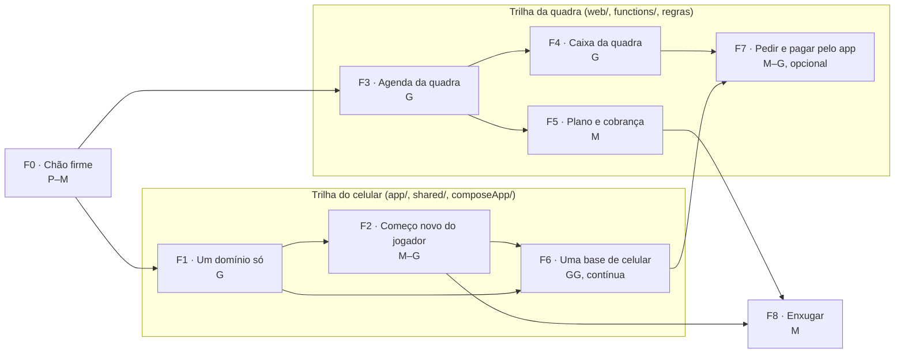

# 06 · Plano de fases, migração, lançamento e métricas

Tudo aqui é **proposta**. Nada começa sem aprovação do Renan. As decisões que travam fases estão no `README.md`.

## 1. Regras de execução

Valem as regras do `PLANO.md` de 04/11, que já funcionaram nas ondas A a I:

1. **Um passo, um branch, um PR**, com squash na `master`.
2. **Teste antes de mexer**: o PR começa por um teste que descreve o comportamento atual.
3. **O novo ao lado do antigo**: mudança de comportamento entra atrás de flag, com o caminho antigo ligado por padrão; a remoção do antigo é um PR separado, depois.
4. **Nada é apagado sem estar listado** (tela, campo, coleção, recurso).
5. **Dado de produção**: exportação antes, script testado no emulador com dados sintéticos, execução em modo de simulação com relatório, e só então a escrita.

Acréscimos deste projeto:

6. **Conversar com dono de quadra antes de construir para ele.** Cinco a dez conversas na Fase 0.
7. **Valor antes de cobrança.** A agenda e o caixa vão ao ar para um piloto gratuito antes de existir página de preços.
8. **A web vai na frente no lado da quadra.** Não depende de loja, dá para corrigir no mesmo dia.

**Tamanho relativo** (esforço, não calendário): P = 1, M = 3, G = 8, GG = 20. Serve para comparar fases entre si.

## 2. Visão geral

As duas trilhas mexem em pastas diferentes e podem andar ao mesmo tempo. Os pontos de contato são três: `firestore.rules`, o modelo de jogo (campo novo `booking_id`) e o índice das Functions. Mudanças nesses três pontos entram em PRs pequenos e próprios.

**Primeiro marco que importa para o negócio**: fim da F3, com 5 arenas-piloto usando a agenda de verdade. Tudo o que vem antes na trilha da quadra serve a esse marco.

## 3. Fases

### F0 · Chão firme

| | |
|---|---|
| **Objetivo** | Parar de perder usuário por defeito e começar a medir, antes de construir |
| **Escopo** | Tela branca na partida e cartão de login cortado. Fechar os PRs de iOS #4548 e #4549. `verify()` do Koin em todos os módulos (Android e `composeApp`). Tirar os e-mails do comentário de `firestore.rules:164-168`. Decidir o que fazer agora com o portão de verificação, que desde 03/10 nega leitura de jogo a quem não verificou. Eventos de funil e de uso por recurso no Analytics (o relógio dos 30 dias para a decisão de cortes começa aqui). Conferir se os orçamentos do Google Cloud existem. Conferir se há infraestrutura de flags no Remote Config (a leitura só achou a chave `level_table`, sem código que a leia). **Cinco a dez conversas com donos de quadra.** |
| **Aceite** | Nenhuma falha de injeção nos testes. 99,5% de sessões sem travamento por 7 dias. Eventos chegando ao Analytics nas três plataformas. Notas das conversas com donos em `docs/modernizacao/`. Flags funcionando de ponta a ponta com uma flag de teste. |
| **Riscos** | Fila de revisão das lojas atrasar a correção. Descobrir, nas conversas, que a premissa do `03` está errada (é o melhor momento para descobrir). |
| **Depende de** | nada |
| **Tamanho** | P–M |
| **Em paralelo** | tudo aqui é independente entre si |

### F1 · Um domínio só

| | |
|---|---|
| **Objetivo** | Android e iOS com os mesmos modelos, repositórios e regras |
| **Escopo** | Mover para o `shared` os modelos que hoje existem em dobro (62 nomes) e apagar o `ModelMappers.kt`. Um `GameRepository`, um `AuthRepository`, um `GroupRepository`, um `LiveGameRepository`. Uma pilha de acesso ao Firebase (sai a de `app/.../data/datasource`). Um banco local (ou nenhum). Documento do usuário criado só pela Function. Times gravados de um jeito só, com leitura compatível com o formato antigo. Placar ao vivo com um escritor só. Casos de teste em JSON para o sorteio de times, valendo para Kotlin e TypeScript. **Fluxo-piloto** (login e abertura) levado para o código comum, atrás de flag, para medir quanto custa migrar uma tela. Opcional: experimento de compilar o `shared` para JavaScript. |
| **Aceite** | `app/.../data/model` sem classe duplicada. Todos os testes atuais passando. Mesmo fluxo-piloto rodando no Android e no iOS pela mesma tela. Relatório curto com o custo real de migrar o fluxo-piloto (alimenta a estimativa da F6). |
| **Riscos** | Regressão silenciosa em nome de campo ao trocar de modelo: mitigar com testes de caracterização que leem documentos no formato de produção. Arquivos gigantes dificultarem a mudança. |
| **Depende de** | F0 |
| **Tamanho** | G |
| **Em paralelo** | com F3 (pastas diferentes) |

### F2 · Começo novo do jogador

| | |
|---|---|
| **Objetivo** | Do link ao "Você está na lista" em menos de 10 segundos, sem cadastro |
| **Escopo** | Tela pública do jogo com **Tô dentro**. Presença como convidado. Login depois da primeira vitória. Notificação pedida com motivo. Login com Google e com Apple no iPhone. Verificação por SMS só para organizador com caixa e para dono; CPF só para quem recebe dinheiro. Criar jogo em três passos. Quatro abas. Tudo no código comum (Android e iOS de uma vez) e na web. |
| **Aceite** | Mediana do toque no link até a confirmação ≤ 10 s, medida por evento. Nenhum pedido de permissão antes da primeira vitória (conferido por teste de tela nas três plataformas). Convidado não ganha XP, não vota e não entra em ranking (teste no servidor). Regras do Firestore com teste para cada caminho do convidado. A interface não contém "IA" (verificação automática dos textos). |
| **Riscos** | Abuso por link público: App Check, limite de chamadas, aprovação de convidado opcional por turma. Revisão das lojas estranhar a conta de convidado: explicar nas notas de revisão; a exclusão de conta já existe. |
| **Depende de** | F1 (fluxo-piloto); decisões 2, 3 e 14 |
| **Tamanho** | M–G |
| **Em paralelo** | com F3 e F4 |

### F3 · Agenda da quadra

| | |
|---|---|
| **Objetivo** | Uma arena consegue tocar a agenda inteira pelo painel, sem vender o mesmo horário duas vezes |
| **Escopo** | Equipe e papéis por arena (migrando `managers[]`). Cadastro de arena por conta própria, em rascunho privado. Grade de dia, semana e lista. Avulso, bloqueio, mover, cancelar, falta. Mensalista com série, exceção, pausa e encerramento. Quadras que dividem espaço. Faixas de preço. Projeção pública de horários ocupados. Ativação da agenda gerenciada com entrada dos jogos futuros como reservas. Criar jogo em arena gerenciada por comando. Auditoria. Verificador de invariantes. Onboarding do dono até "Sua agenda está pronta" e do funcionário. Web e Functions; nada nos apps. |
| **Aceite** | Teste de concorrência: 100 tentativas simultâneas no mesmo horário, exatamente uma passa. Verificador de invariantes em zero por 30 dias de piloto. Um teste de regra por célula da tabela de papéis. Mediana de até 90 s do toque em "Montar minha agenda" até a agenda pronta, medida com os donos do piloto. Cinco arenas com pelo menos 10 horários marcados por semana, por 4 semanas. |
| **Riscos** | Modelar a operação errada (mitigado pelas conversas da F0 e pelo piloto). Versões antigas do app criando jogo direto em arena gerenciada: janela de compatibilidade e versão mínima (`05`, seção 13). |
| **Depende de** | F0; decisões 1, 8, 13 |
| **Tamanho** | G |
| **Em paralelo** | com F1 e F2 |

### F4 · Caixa da quadra

| | |
|---|---|
| **Objetivo** | O dono sabe quem deve, o que entrou e se a gaveta bate |
| **Escopo** | Clientes. Cobranças. Receber (formas, parcial, crédito). Código Pix válido com a chave da arena. Estorno. Despesas. Modo simples e modo por turno (abertura, sangria, suprimento, contagem às cegas, diferença, visto). Mensalidades nos dois modos. A receber e atraso, com lembrete manual pelo WhatsApp. Relatórios. Exportação em CSV e PDF. Travar mês. |
| **Aceite** | Propriedade "soma dos lançamentos = resumos" em teste, com casos gerados. Código Pix aceito por pelo menos três bancos diferentes (teste manual, valores pequenos). Exportação abre no Excel em português sem ajuste. No piloto, fechamento batendo com a contagem por 10 dias seguidos em pelo menos 3 arenas. Nenhuma escrita de cliente em coleção de dinheiro (teste de regra). |
| **Riscos** | Regra de mensalidade não bater com a prática dos donos (validar os dois modos nas conversas). Erro em dinheiro custa confiança: por isso nada é editável e tudo é estornável. |
| **Depende de** | F3 |
| **Tamanho** | G |
| **Em paralelo** | com F2 e com o começo da F5 |

### F5 · Plano e cobrança

| | |
|---|---|
| **Objetivo** | A arena contrata, paga e gerencia o plano sozinha, pela web |
| **Escopo** | Página `/quadras` com agenda de demonstração. Planos e limites aplicados no servidor. Integração com o provedor (assinatura, Pix Automático, cartão, boleto) e recebimento dos avisos de pagamento. Fim do teste levando ao plano Vitrine. Régua de atraso e suspensão. Reivindicação de arena existente e confirmação de titularidade. Processo de nota fiscal. Termos do plano e contrato de tratamento de dados. |
| **Aceite** | Ciclo completo no ambiente de teste do provedor: assinar, pagar, atrasar, suspender, regularizar, trocar de plano, cancelar. Aviso de pagamento repetido ou com assinatura inválida não muda nada (teste). Exportação disponível com o plano suspenso. Lista de conferência das lojas cumprida: nenhum preço, botão ou link de compra nos apps. Primeira nota fiscal emitida. |
| **Riscos** | Jurídico e contador no caminho crítico. Preço errado (mitigado pelo piloto). |
| **Depende de** | F3 (valor antes de cobrar); decisões 1, 5, 6, 7 e 12 |
| **Tamanho** | M |
| **Em paralelo** | com F4. O **piloto pago manual** (comprovante + conferência, que já existe) pode começar antes da integração |

### F6 · Uma base de celular

| | |
|---|---|
| **Objetivo** | Android e iOS com as mesmas telas; o iOS chega à paridade |
| **Escopo** | Fluxo a fluxo, levando as telas do Android para o código comum: Jogos (detalhe, presença, times, ao vivo, votação) → Turmas (com caixa e mensalidade da turma) → Quadras (lado do jogador) → Perfil (estatísticas, conquistas). Textos para recursos multiplataforma. Ao fim, `app/` é só a casca do Android. |
| **Aceite (por fluxo)** | Mesma tela nas duas plataformas. Flag em 100% por duas semanas sem piora de travamentos. Caminho antigo removido em PR separado. Roteiro manual no Simulador e no Android cumprido. |
| **Riscos** | É o maior item. Risco de parar no meio com duas bases: por isso cada fluxo é completo em si e o app funciona em qualquer ponto intermediário. |
| **Depende de** | F1 (inclusive do custo medido no fluxo-piloto) |
| **Tamanho** | GG |
| **Em paralelo** | com toda a trilha da quadra |

### F7 · Pedir horário e pagar pelo app (opcional)

| | |
|---|---|
| **Objetivo** | O organizador acha horário livre e fecha com a quadra sem sair do app |
| **Escopo** | Horários livres na página da arena. Pedir horário; aprovação pela arena (ou automática). Lista de espera da quadra. Opcional: Pix conciliado em subconta da arena. Opcional: modo dono nos apps ou app separado para quadras. |
| **Aceite** | Pedido aprovado vira reserva e jogo ligados. Nenhuma dupla marcação entre balcão e app (mesmo teste de concorrência). Se houver Pix conciliado: baixa automática conferida contra o extrato do provedor. |
| **Riscos** | Perguntas regulatórias e de política de loja (`04`, seções 7 e 8). |
| **Depende de** | F3, F4, parte da F6; decisões 5 e 11; jurídico |
| **Tamanho** | M–G |

### F8 · Enxugar

| | |
|---|---|
| **Objetivo** | Menos coisa para manter, menos leitura por sessão |
| **Escopo** | Recursos que a decisão 9 mandar sair: flag, depois remoção listada. Coleções legadas (`fields` na raiz, `locations/*/availability`, `games/*/confirmations` se confirmado sem uso). Um despachante no lugar dos 11 gatilhos de `games`. Fila de notificações sem a tarefa de minuto em minuto. *Listeners* com limite. Onda E do plano de 04/11 (dependências), que ficou pendente. Linhas de base do lint e do detekt. |
| **Aceite** | Leituras por sessão ≤ 80, medidas. Nenhum dado de usuário perdido (contagens antes e depois). Exportação "meus dados" ainda traz o que foi desligado. |
| **Riscos** | Remover algo que alguém usa: por isso os 30 dias de dados e a flag antes. |
| **Depende de** | 30 dias de medição (F0); decisão 9 |
| **Tamanho** | M |
| **Em paralelo** | pode ser fatiada ao longo das outras |

## 4. Migração de dados

### 4.1 Garantia para quem já usa

Nenhuma coleção do jogador muda de formato: usuários, jogos, presenças, estatísticas, XP, conquistas, temporadas, caixa e mensalidade da turma ficam como estão. A unificação de modelos (F1) é mudança de código nos clientes, não de dados. Quem tem "Sem anúncios" continua tendo.

### 4.2 Passos

| # | O que | Quando | Como | Volta atrás |
|---|---|---|---|---|
| M1 | `managers[]` → documentos de equipe | F3 | script que cria `staff/{uid}` para o dono e para cada gerente; o vetor continua sendo escrito por algumas versões | apagar os documentos criados (o vetor não foi tocado) |
| M2 | Padrões da arena (grade, modo de caixa, agenda gerenciada desligada) | F3 | preenchimento na leitura; sem escrita em massa | não há o que desfazer |
| M3 | Regra "só aparece se estiver em dia" → "aparecer é grátis" | F5, se a decisão 1 for sim | mudança de regra e de Function; locais verificados continuam aparecendo; os suspensos por cobrança voltam à vitrine | reverter a regra |
| M4 | Jogos futuros → reservas | por arena, no momento em que o dono liga a agenda gerenciada | comando que lê os jogos futuros daquela arena, cria as reservas e marca conflitos para resolução manual | desligar a agenda gerenciada da arena; as reservas criadas pela importação são apagadas |
| M5 | Times gravados pela web dentro do jogo → formato único | F1 | leitura compatível com os dois formatos primeiro; conversão dos antigos depois, com simulação e relatório | o campo antigo fica até a F8 |
| M6 | Conta de convidado | F2 | não há migração; é comportamento novo | flag |
| M7 | `games/*/confirmations` e `fields` na raiz | F8 | primeiro confirmar que ninguém lê (registros de acesso por 30 dias); depois exportar e remover | restaurar da exportação |
| M8 | Recursos desligados | F8 | os dados ficam; some a navegação; a exportação continua trazendo | religar a flag |
| M9 | Preço das quadras (zero em produção) | onboarding do dono | o dono preenche; nada é inventado | n/a |
| M10 | Conta comercial (`venue_accounts`) | F5 | acrescenta origem do pagamento e identificador do provedor; o histórico manual continua válido | campos novos são opcionais |

### 4.3 Procedimento de cada passo com dado de produção

1. Exportação do Firestore para um bucket com data (o procedimento está em `docs/FIRESTORE_BACKUP_RESTORE.md`).
2. Script idempotente, testado no emulador com dados sintéticos no formato de produção.
3. Simulação em produção, com relatório do que seria escrito.
4. Leitura do relatório pelo Renan.
5. Escrita, em lotes, com registro do que foi feito.
6. Conferência: contagens antes e depois, e o verificador de invariantes.

Recuperação pontual do Firestore: não verifiquei se está ligada no projeto. Vale conferir antes do primeiro passo.

## 5. Lançamento e volta atrás

### 5.1 Ordem

1. **Web, painel do dono**, para as arenas-piloto, em canal de prévia do Hosting e depois em produção atrás de flag por arena.
2. **Web, jogador** (página pública do jogo e começo novo).
3. **Android**, depois **iPhone**, com o começo novo e os fluxos migrados, cada um atrás de flag.
4. **Cobrança**, quando o piloto disser que vale pagar.

### 5.2 Por plataforma

| Plataforma | Como lança | Como volta atrás |
|---|---|---|
| **Web** (Hosting) | canal de prévia para o piloto; produção com flag | voltar à versão anterior pelo console do Hosting; desligar a flag |
| **Functions** | implantação por alvo, função a função | reimplantar a versão anterior; comandos novos são aditivos |
| **Regras do Firestore** | implantação separada, depois dos testes de regra; janela em que a regra aceita o caminho antigo e o novo | reimplantar o arquivo anterior (versionado no git) |
| **Android** (Play) | teste interno → teste fechado → produção em etapas (5%, 20%, 50%, 100%), observando travamentos entre etapas | interromper a distribuição em etapas; não existe "desinstalar a versão": a volta é desligar a flag e, se preciso, publicar uma correção com número de versão maior |
| **iPhone** (App Store) | TestFlight → lançamento gradual de 7 dias | pausar o lançamento gradual; desligar a flag; correção com pedido de revisão acelerada, se for grave |

**Consequência de desenho**: como nas lojas não há volta de versão, todo comportamento novo tem de poder ser desligado pelo servidor. Flag não é opcional neste projeto.

### 5.3 Notas para a revisão das lojas

- Conta de teste do revisor (já existe para o Play, conforme o inventário de credenciais).
- Explicar o modo convidado e onde fica a exclusão de conta.
- Declarar que o app não vende plano de quadra e não tem link de compra (`04`, seção 8.3).
- As fichas não falam de preço nem de compra no site.
- Formulários de segurança de dados e rótulos de privacidade revisados quando entrarem a conta de convidado e, depois, os dados de cliente de quadra (que ficam na web, mas a política é uma só).

### 5.4 Piloto com arenas

- 5 a 10 arenas, de graça por 60 a 90 dias, escolhidas entre as que já recebem peladas do app [suposição de que existem; não verifiquei].
- Um contato por semana com cada uma; o que elas pedem vira lista priorizada, não promessa.
- Critério para abrir a cobrança: pelo menos 3 arenas dizendo, sem ser perguntadas, que não querem voltar ao caderno.
- Abordagem um a um, por pessoa autorizada; nada de disparo em massa (regra que a documentação comercial já traz).

## 6. Métricas de sucesso

Metas são pontos de partida [suposição]. O importante é medir desde a F0.

| Área | Métrica | Meta inicial | Como medir |
|---|---|---|---|
| Jogador | tempo do link à primeira presença (mediana) | ≤ 10 s | evento no Analytics |
| Jogador | quem abriu um link e confirmou presença | ≥ 60% | funil |
| Jogador | convidados que criam conta em 7 dias | ≥ 40% | funil |
| Organizador | criou o jogo e mandou o link na primeira sessão | ≥ 50% | funil |
| Retenção | jogador ativo na 4ª semana | a medir; ainda não há linha de base | coortes |
| Quadra | da página à agenda pronta (mediana) | ≤ 90 s | evento |
| Quadra | arenas ativadas (10 horários em 7 dias) | 40% das que montaram agenda | consulta |
| Quadra | arenas ativas na 8ª semana | ≥ 60% das ativadas | consulta |
| Quadra | dupla marcação | 0 | verificador de invariantes |
| Quadra | dias com fechamento batendo | ≥ 95% no modo por turno | resumo dos turnos |
| Negócio | conversão do teste para plano pago | a medir no piloto | conta comercial |
| Negócio | receita mensal recorrente e cancelamentos | acompanhar | livro-razão da assinatura |
| Negócio | jogadores trazidos por arena | acompanhar | origem do primeiro acesso |
| Qualidade | sessões sem travamento | ≥ 99,5% | Crashlytics |
| Qualidade | criar reserva e receber (p95) | ≤ 1,5 s | registros das Functions |
| Qualidade | falhas de injeção em produção | 0 | Crashlytics |
| Custo | leituras por sessão | ≤ 80 | uso do Firestore ÷ sessões |
| Custo | Firebase por usuário ativo | < US$ 0,01 por mês | fatura ÷ usuários ativos |
| Manutenção | implementações por funcionalidade nova | 2 (celular e web) | contagem por PR |
| Manutenção | linhas em `app/` | queda contínua até sobrar a casca | contagem |

## 7. Riscos do projeto como um todo

| Risco | Probabilidade | Efeito | Resposta |
|---|---|---|---|
| Construir para o dono sem entender o dono | média | meses jogados fora | conversas na F0; piloto antes de cobrar |
| Parar a convergência do celular no meio | média | três bases viram três e meia | cada fluxo é uma entrega completa; o app funciona em qualquer ponto |
| Uma pessoa só para tudo | alta | atraso | duas trilhas no máximo; a F7 é opcional; a F8 é fatiável |
| Revisão das lojas barrar algo do lado do dono | baixa na opção 1 | retrabalho | painel só na web; nada de compra nos apps |
| Erro em dinheiro no piloto | baixa, com efeito alto | perda de confiança | nada editável, tudo auditado, verificador noturno, piloto pequeno |
| Jurídico e contador atrasarem a cobrança | média | F5 parada | começar a conversa na F0; piloto pago manual não depende de integração |
| Abuso pelo modo convidado | média | lixo em listas de presença | App Check, limites, aprovação opcional, convidado sem pontuação |
| Poucas arenas querem pagar | desconhecida | modelo não fecha | é exatamente o que o piloto responde, com custo baixo |

## 8. Não verificado

- Quantas arenas existem hoje na base e quantas recebem peladas.
- Se há infraestrutura de flags pronta no Remote Config.
- Se a recuperação pontual do Firestore está ligada.
- Quanto custa de verdade migrar uma tela do Android para o código comum (a F1 mede).
- Situação atual das revisões nas lojas.
- Nenhuma estimativa de calendário foi feita: os tamanhos são relativos.
